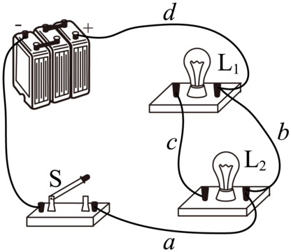

# Physics - 题目 1856

**ID**: 7c91823c2d4b428dae2390e4dabaec9e
**年级**: Grade 9
**难度**: Medium
**题型**: Experiment

## 题目
小明和小伟在连接串并联电路的实验中：(1)在连接电路的过程中，开关应该（填“断开”或“闭合”）；(2)小明连接了如图所示电路，如果闭合开关，两个灯泡都将（填“不会发光”或“会被烧坏”），出现（填“断路”、“短路”或“通路”）现象；(3)小明想将电路全部拆散，重新连接。​​​​​​​‌小伟认为只需拆除（填字母）这一根导线，就能成为串联电路；(4)在（3）正确拆除完导线的基础上，两灯串联，他们闭合开关发现两灯同时亮，断开开关两灯同时灭；将开关S换接到L_{1}和L_{2}之间、L_{1}和电池正极之间，观察到同样的现象。说明在串联电路中，开关在任何位置控制作用。(5)改变成并联电路后若拆掉其中一个灯泡后，小明结合实验现象得出了初步结论：并联电路中各支路用电器。

## 解答

1. （1）为了保护电路，在连接电路过程中，开关应该断开。
2. （2）[1][2]由图所示，电流从电源正极流出后未经过两灯泡，直接到了开关S后回到负极，所以两个灯泡都不会发光，出现短路现象。
3. （3）串联电路中各用电器之间互相影响，不独立工作，电流只有一条路径，所以拆除导线b即可构成串联电路。
4. （4）由题意可知，虽然开关的位置发生了变化，但是其控制作用不变，所以说明了在串联电路中，开关在任何位置控制作用不变。
5. （5）并联电路中，各用电器之间相互不影响，所以拆掉其中一个灯泡后，另一个灯泡仍然发光，故可以根据此现象得出结论：并联电路中各支路用电器相互不影响。

## 知识点

**中文**:
  - 串联电路
  - 并联电路

**English**:
  - Series Circuits
  - Parallel Circuits

---
