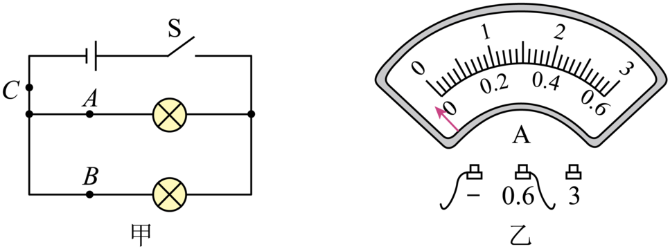

# Physics - 题目 2226

**ID**: 7fdc3693b5cc4e5a91054ee6b0f03b28
**年级**: Grade 9
**难度**: Medium
**题型**: Experiment

## 题目
小明为了探究并联电路中电流的特点，设计了如图甲所示的电路图：实验次数A点电流I_{A}/AB点电流I_{B}/AC点电流I_{C}/A10.010.250.2620.220.360.5831.21.32.540.301.51.80（1）按照图甲电路图连接实物电路，将电流表接入电路，应选择（选填“0~0.6A”或“0~3A”）的测量范围进行“试触”。​​​​​​​‌闭合开关S后，电流表的指针出现如图乙所示情况，原因是：。（2）改正问题后，小明将电流表分别接入图甲电路中的A、B、C处，测出多组电流如表所示。分析数据，小明得出结论：在并联电路中，干路电流等于各支路中的电流之。同组的小红同学分析实验数据后认为第1组实验数据是编造的，判断依据是：。

## 解答

1. （1）电流表在接入电路时，若不知道电路中的电流大小，应选择电流表的大量程（0~3A）进行试触，防止电路中电流过大使电流表损坏，试触时，若指针偏转大，则选择大量程，否则选择小量程。
2. 闭合开关S后，即电路已经通路，电流表的指针出现如图乙指针偏向零刻度线左侧，说明电流表正负接线柱接反了，导致的指针反偏，电流表接入电路时，电流必须正进负出。
3. （2）由表中数据，可知，2、3、4三组实验，A点的电流与B点的电流之和始终等于C点的电流，因此可得出结论，在并联电路中，干路电流等于各支路中的电流之和。
4. 实验1中，A点电流0.01A是编造的，因为实验室实验的电流表，小量程（0~0.6A）的分度值为0.02A，大量程（0~3A）的分度值为0.1A，该数据比分度值小，这是不可能的。

## 知识点

**中文**:
  - 探究串、并联电路的电流规律实验

**English**:
  - Experiment: Current Laws in Series/Parallel

---
