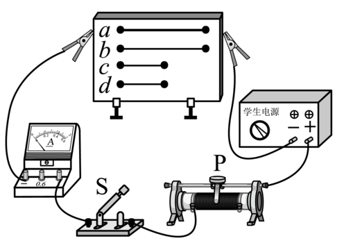

# Physics - 题目 1837

**ID**: 7ff80579bd10458caa022a72663a34f8
**年级**: Grade 9
**难度**: Medium
**题型**: Experiment

## 题目
某实验小组在“探究影响电阻大小的因素”时，选出符合要求的学生电源、滑动变阻器、电流表、开关、导线若干以及几种电阻丝，电阻丝的参数如下表。​​​​​​​‌编号材料长度/m横截面积/ ${\rm mm}{^{2}}$a镍铬合金丝1.00.2b镍铬合金丝1.00.1c镍铬合金丝0.50.1d锰铜合金丝0.50.1小组成员作出了如下猜想，并设计了如图所示的电路。猜想1：电阻大小与导体的长度有关；猜想2：电阻大小与导体的材料有关；猜想3：电阻大小与导体的横截面积有关。请回答下列问题：(1)实验通过比较的大小，来比较电阻丝电阻的大小；(2)若要验证猜想1，则应该选用（填编号）两根电阻丝进行对比实验；(3)选用c、d两根电阻丝进行对比实验，目的是验证猜想（选填“1”“2”或“3”）。

## 解答

1. (1)[1]实验中采用了转换法比较电阻大小，即通过比较电流表示数来比较导体电阻的大小。
2. (2)[2]若要验证猜想1电阻大小与导体的长度有关，应控制导体的材料和横截面积不变，编号b、c的电阻丝符合。
3. (3)[3]选用c、d两根电阻丝可知，两者的长度相同、横截面积相同，材料不同，是验证导体的电阻与导体的材料是否有关，即验证了猜想2。

## 知识点

**中文**:
  - 影响导体电阻大小因素的探究实验

**English**:
  - Experiment: Factors Affecting Resistance

---
