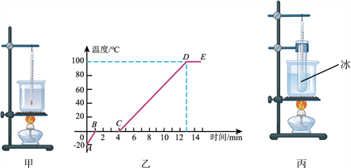

# Physics - 题目 2434

**ID**: 84b18ef4e65e4f6e826a30f055208665
**年级**: Grade 9
**难度**: Medium
**题型**: Experiment

## 题目
在物理实验课上，同学们分了若干小组做“探究冰熔化时温度的变化规律”和“探究水沸腾时温度变化的特点”两个实验，如图所示。​​​​​​​‌（1）A组在图甲的烧杯中加入碎冰，等冰熔化成水再进行加热直至沸腾，在此过程中通过测量绘制了温度随时间变化的图象，如图乙所示。根据图象分析，冰的熔点是，表示冰熔化过程是段；由实验可知，冰在熔化过程中温度的特点是：；（2）B组利用图丙的实验装置“探究冰熔化时温度的变化规律”。这实验方法的优点是：；试管中的冰完全熔化后，B组持续加热，继续“探究水沸腾时温度变化的特点”，发现在标准大气压下能得到图象中的DE段，但这段时间内试管中的水（选填“能”或“不能”）沸腾，是因为；（3）C和D两组同学选用相同的实验装置“探究水沸腾时温度变化的特点”，水的初温相同，且同时开始实验，但C组烧杯中的水先开始沸腾，原因可能是：。

## 解答

1. （1）[1][2][3]图乙中，BC段温度保持不变，这个过程所对应的温度0℃就是该晶体的熔点，表示冰熔化过程是BC段；晶体熔化过程中，不断吸收热量，温度的特点是：温度保持不变。
2. （2）[4]水浴法加热的优点是：试管中的冰各个方向都能从烧杯吸收热量，使冰受热均匀。
3. [5][6]烧杯中的水沸腾后，继续吸收热量但温度不变，试管中的水和烧杯中的水温度相同，能达到沸点，但不能继续从烧杯中吸热，所以不能沸腾。
4. （3）[7]C和D两组同学选用相同的实验装置，水的初温相同，且同时开始实验，C组烧杯中的水比D组先沸腾，两杯水的沸点相同，所以C组烧杯中水的质量少，也可能是D组没有用酒精灯的外焰加热。

## 知识点

**中文**:
  - 探究水的沸腾实验
  - 熔化和凝固的探究实验

**English**:
  - Experiment: Boiling of Water
  - Experiment: Melting and Solidification

---
