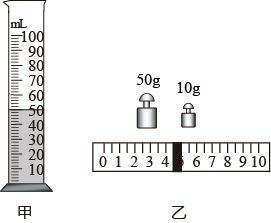

# Physics - 题目 574

**ID**: 856713a73a3048048bcef351e341d731
**年级**: Grade 9
**难度**: Medium
**题型**: Experiment

## 题目
小红和小敏决定用不同的测量工具测量她们都喜欢吃的土豆的密度。​​​​​​​‌（1）小红打算用天平和量筒来测量土豆的密度，但决定用“替代法”。

## 解答

1. （1）A．小红用“替代法”测量土豆的密度，所以向容器中加盐并搅拌直至土豆处于悬浮状态，此时 $ρ{{}_{土豆}}=ρ{{}_{盐水}}$ ，测量盐水的密度即可知土豆的密度。
2. 把天平放在水平桌面上，发现指针在中央刻度线两边来回摆动，但偏向左侧的角度较大，她应将平衡螺母向右调节。
3. B．请根据以上操作填好下表的空格：
4. a．把盐水倒进量筒，由图甲知：用量筒测出盐水的体积V＝50mL=50cm^{3}
5. c．图乙：用天平测出容器和盐水的总质量
6. m_{总}=50g+10g+4.5g=64.5g
7. d．盐水的密度
8. $ρ{{}_{盐水}}=\frac {m{{}_{盐水}}}{V}=\frac {m{{}_{总}}-m{{}_{杯}}}{V}=\frac {64.5{\rm{g}}-10.5{\rm{g}}}{50{\rm{c}}{\rm{m}}{^{{\rm{3}}}}}=1.08{\rm{g}}{\rm{/}}{\rm{c}}{\rm{m}}{^{3}}=1.08\times 10{^{3}}{\rm{k}}{\rm{g}}{\rm{/}}{\rm{m}}{^{3}}$
9. C．如本次实验按上述的a、b、c、d顺序操作，由于盐水附着在量筒上，会使得所测质量偏小，故导致测出的盐水密度小于实际盐水的密度。
10. （2）小红决定用弹簧测力计测量土豆的密度。
11. A．在空气中测量出土豆的重力G；
12. B．将土豆浸没于水中，测出弹簧测力计的拉力F，则土豆受到的浮力
13. $F{{}_{浮}}=G-F=ρ{{}_{水}}gV{{}_{排}}$
14. 所以土豆的体积
15. $V=V{{}_{排}}=\frac {G-F}{ρ{{}_{水}}g}$
16. C．因为G=mg=ρVg，所以土豆的密度
17. $ρ=\frac {G}{Vg}=\frac {G}{\frac {G-F}{ρ{{}_{水}}g}g}=\frac {G}{G-F}ρ{{}_{水}}$

## 知识点

**中文**:
  - 固体密度的测量实验

**English**:
  - Experiment: Measuring Density of Solids

---
