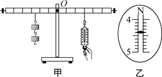

# Physics - 题目 2475

**ID**: 868cc88a802f41438e733c5ab72097fa
**年级**: Grade 9
**难度**: Medium
**题型**: Experiment

## 题目
小飞用图甲装置来探究杠杆的平衡条件，设弹簧测力计和钩码对杠杆的拉力分别为动力F_{1}和阻力F_{2}，l_{1}和l_{2 }分别表示动力臂和阻力臂。​​​​​​​‌他的实验思路是：改变F_{2}、l_{1}和l_{2}，测得杠杆平衡时所需的拉力F_{1}，来寻找F_{1}、F_{2}、l_{1}和l_{2 }四个物理量之间的关系。已知实验前已调节杠杆在水平位置平衡，弹簧测力计的量程为 0~5N，杠杆上每一格长 10cm。（1）为便于测量力臂，弹簧测力计应沿方向拉杠杆，并使之在位置平衡；（2）小飞首先保持F_{2 }和l_{1 }不变而改变l_{2}，所获得的实验数据如图表格所示。第 1 次实验中弹簧测力计示数的放大图如图乙所示，则F_{1}=N；（3）为获得更多组数据，小飞继续进行（2）中实验，为能顺利完成实验，在改变阻力臂l_{2 }时，l_{2}应不超过cm；完成上述实验后，小飞接下来还应进行的实验有：①保持不变而改变F_{2}；②保持F_{2}和l_{2 }不变而改变l_{1}。

## 解答

1. （1）[1][2]为了方便测量力臂，弹簧测力计应沿竖直方向拉杠杆，使杠杆在水平位置平衡，因为杠杆在水平位置平衡后，从杠杆上直接读取力臂。
2. （2）[3]图中弹簧测力计的分度值是0.1N，指针指在4N下面第4个小格上，因此弹簧测力计读数为
3. 4N+0.1N×4=4.4N
4. （3）[4]当F_{2}=4N，动力臂l_{1}=30cm不变时，弹簧测力计的最大拉力为5N，根据杠杆平衡条件可得在改变阻力臂l_{2}时，l_{2}应不超过的数值
5. $l{{}_{2}}=\frac {F{{}_{1}}\times l{{}_{1}}}{F{{}_{2}}}=\frac {5{\rm{N}}\times 30{\rm{c}}{\rm{m}}}{4{\rm{N}}}=37.{\rm{5}}{\rm{c}}{\rm{m}}$
6. [5]根据控制变量法可知，探究F_{1}与F_{2}的关系必须保持l_{1}和l_{2}不变。

## 知识点

**中文**:
  - 探究杠杆的平衡条件实验

**English**:
  - Experiment: Equilibrium Conditions of Levers

---
