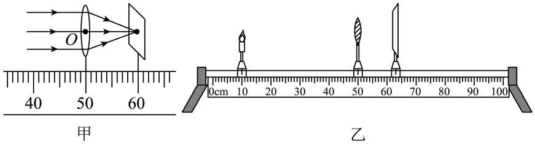

# Physics - 题目 752

**ID**: 872e615dab8f435d8c00043c2ac44556
**年级**: Grade 9
**难度**: Medium
**题型**: Experiment

## 题目
吴江小组进行“探究凸透镜成像规律”实验，如图所示，实验桌上备有带支架的蜡烛、光屏、一个凸透镜、平行光光源（接通电源后可发出平行光）、光具座等器材，他们进行了如下操作并得出了相关结论。​​​​​​​‌(1)如图甲所示，让平行光光源正对着凸透镜照射，把光屏置于另一侧，改变光屏与凸透镜间的距离。直到光屏上出现一个最小最亮的光斑，测得凸透镜的焦距是${\rm{c}}{\rm{m}}$ ；(2)将蜡烛、透镜和光屏放在光具座上，并使烛焰、透镜和光屏三者的中心大致在；(3)吴江小组按照实验步骤做了四次实验，如图乙所示是第一次实验中蜡烛、透镜和光屏的位置。实验序号物距 $u{\rm{/}}{\rm{c}}{\rm{m}}$像距 $v{\rm{/}}{\rm{c}}{\rm{m}}$像的性质14013△22020倒立、等大的实像31340倒立、放大的实像46无正立、放大的虚像①吴江小组忘了记录第1次像的性质，表格中标有“△”的位置像的性质是；②当烛焰从远处靠近透镜时，仍要在光屏上得到清晰的像，光屏应透镜（选填“远离”或“靠近”）；③第4次实验中，光屏上接收不到像；在透镜的右侧观察，看到的像在透镜的侧（选填“左”或“右”）。

## 解答

1. (1)由图可知，凸透镜在50.0cm处，光屏上出现一个最小最亮的光斑即为凸透镜的焦点，此时光屏在60.0cm处，则凸透镜的焦距为10.0cm。
2. (2)为了使像成在光屏中央应使烛焰、透镜和光屏三者的中心大致在同一高度。
3. (3)①第1次实验物距40cm大于二倍焦距由凸透镜成像规律可知，此时成倒立缩小的实像。
4. ②成实像像时，烛焰从远处靠近透镜时，即物距减小时，像距增大，光屏应远离透镜。
5. ③第4次实验中，物体在一倍焦距以内，成正立放大的虚像。所以在透镜的右侧观察，看到的像在透镜的左侧。

## 知识点

**中文**:
  - 凸透镜成像规律的探究实验

**English**:
  - Experiment: Imaging Rules of Convex Lenses

---
