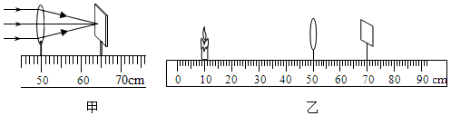

# Physics - 题目 1102

**ID**: 87cdab211f5b429da5e2a887bad92a04
**年级**: Grade 9
**难度**: Medium
**题型**: Experiment

## 题目
小明利用光具座、凸透镜、蜡烛、光屏等实验器材探究凸透镜成像的规律。​​​​​​​‌实验时，他把凸透镜始终固定在光具座50cm刻度线处。(1)小明通过图甲的实验操作，确定了该凸透镜的焦距f=；(2)小明将蜡烛移至光具座上10cm刻度线处，如图乙所示，移动光屏，直到烛焰在光屏上成清晰的像，则该像是倒立、的实像；(3)小明又将蜡烛移至光具座上25cm刻度线处，为在光屏上再次得到清晰的像，应将光屏向（选填“靠近”或“远离”）透镜的方向移动，应用这一成像特点可制成的光学仪器是；(4)小明将蜡烛移至光具座上40cm刻度线处，移动光屏，发现不能在光屏上得到像，为了观察此时成像特点，请你写出接下来的操作是：；此时，小明将蜡烛继续靠近透镜，看到的像将（选填“变大”、“变小”或“不变”）。

## 解答

1. (1)[1]由图甲可知，平行于凸透镜主光轴的光线，经凸透镜折射后会聚于主光轴上的一点，这一点就是凸透镜的焦点，凸透镜焦点到凸透镜光心的距离就是凸透镜的焦距，即甲图中凸透镜到光屏的距离，故该凸透镜的焦距f=15cm。
2. (2)[2]如图乙，小明将蜡烛移至光具座上10cm刻度线处，这时物距为40cm大于2倍焦距，移动光屏，直到烛焰在光屏上成清晰的像，根据凸透镜的成像规律，该像是倒立、缩小的实像。
3. (3)[3][4]小明又将蜡烛移至光具座上25cm刻度线处，物距变小，根据凸透镜成像规律，像距变大，为在光屏上再次得到清晰的像，应将光屏向远离透镜的方向移动，应用这一成像特点可制成的光学仪器是幻灯机（投影仪）。
4. (4)[5]小明将蜡烛移至光具座上40cm刻度线处，这时物距为10cm小于焦距，根据凸透镜成像规律，这时成正立、放大的虚像，像与物在凸透镜的同一侧，虚像不能用光屏承接，所以移动光屏，不能在光屏上得到像，但虚像可以用眼睛观察，为了观察此时成像特点，用眼睛在光屏一侧透过凸透镜可观察所成的像（正立、放大的虚像）。
5. [6]小明将蜡烛继续靠近透镜，物距变小，根据凸透镜的成像规律，所成的虚像变小，所以看到的像将变小。

## 知识点

**中文**:
  - 凸透镜成像规律的探究实验

**English**:
  - Experiment: Imaging Rules of Convex Lenses

---
