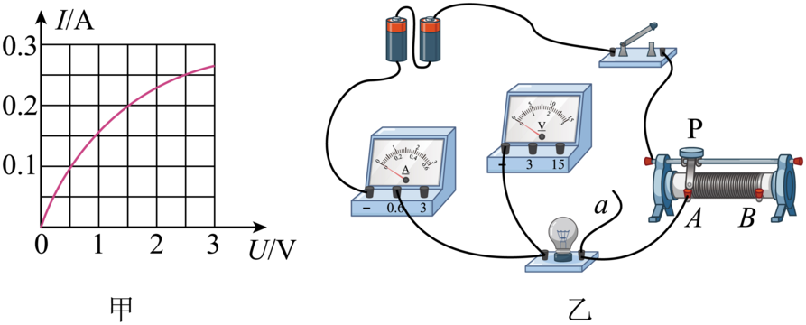

# Physics - 题目 1609

**ID**: 883bd7feed614369af7ea6d4a1b9fed2
**年级**: Grade 9
**难度**: Medium
**题型**: Experiment

## 题目
图甲是“测量小灯泡功率”实验电路，电源电压3V，小灯泡的额定电压为2.5V。​​​​​​​‌（1）连接电路时，图中导线a端应与电压表上标有数字“”（选填“3”或“15”）的接线柱相连；（2）根据实验数据画出I-U图像，如图乙所示，则小灯泡的额定功率是W；（3）结合图甲的信息思考：能否利用图乙电路，采用控制变量的方法来“探究电流与电压的关系”？并说明理由。

## 解答

1. （1）电源电压3V，故电压表选用小量程与灯并联，连接电路时，图中导线a端应与电压表上标有数字3的接线柱相连。
2. （2）由图甲可知，小灯泡的额定电压为2.5V，对应的额定电流为0.25A，小灯泡的额定功率
3. P_{额}=U_{额}I_{额}=2.5V×0.25A=0.625W
4. （3）探究“探究电流与电压的关系”，要控制电阻的大小不变，而灯的电阻随温度的变化而变化，故不能探究电流与电压的关系。

## 知识点

**中文**:
  - 伏安法测量小灯泡的电功率

**English**:
  - Measuring Bulb Power (Voltammetry)

---
