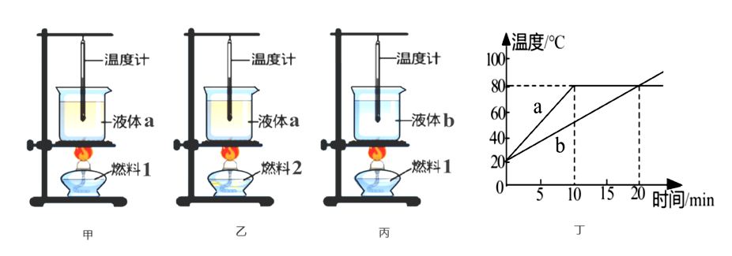

# Physics - 题目 2525

**ID**: 8bb5207ecd09437a889d1c69cd0c067d
**年级**: Grade 9
**难度**: Medium
**题型**: Experiment

## 题目
如图所示，甲、乙、丙图中的装置完全相同，燃料的质量都是20g，烧杯内的液体质量和初温也相同。​​​​​​​‌（1）下列说法正确的是；

## 解答

1. (1)AB．为了比较不同燃料的热值大小，要用不同的燃料，加热质量相同的同种液体，故选用甲、乙两图，故AB错误。
2. CD．比较不同物质的吸热能力，则需要燃烧相同的燃料（确保相同时间放出的热量相同），加热相同的时间，比较质量和初温相同的液体升高的温度，可以选择甲、丙两图，故C正确，D错误。
3. 故选C。
4. (2)根据转换法，不同物质吸热的多少是通过加热时间来反映的，加热10min，a液体吸收的热量等于b液体吸收的热量。
5. 由图可知，两种物质都升高80℃﹣20℃=60℃
6. a的加热时间为10min，b的加热时间为20min，b加热时间长，b吸收的热量为a吸收热量的2倍，由比较吸热能力的方法，b的吸热能力强。
7. 根据可知，在液体的质量相同、升高相同的温度时，比热容与吸收的热量成正比，b吸收的热量为a吸收热量的2倍，则b的比热容为a的比热容的2倍，即a的比热容为 $c{{}_{{\rm{a}}}}=\frac {1}{2}c{{}_{{\rm{b}}}}=\frac {1}{2}\times 2.4\times 10{^{3}}{\rm{J}}/\left ({kg·℃}\right )=1.2\times 10{^{3}}{\rm{J}}/\left ({kg·℃}\right )$
8. 根据可知，相同质量的b、a两种物质升高相同的温度，因b的比热容大，故b吸热多，故若要在a、b中选择某种液体作为冷却液，应选用b。

## 知识点

**中文**:
  - 探究燃料的热值实验
  - 物质的比热容探究实验

**English**:
  - Experiment: Investigating Calorific Value
  - Experiment: Investigating Specific Heat Capacity

---
