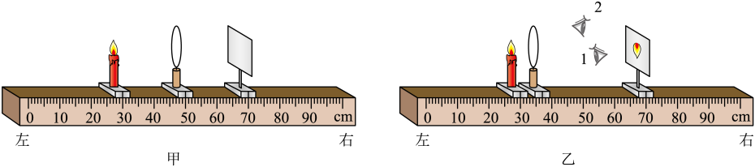

# Physics - 题目 1777

**ID**: 8cc71a2de0e44da8ba69d104c0dbfc2d
**年级**: Grade 9
**难度**: Medium
**题型**: Experiment

## 题目
小明利用如图所示的装置探究凸透镜成像规律：（1）当蜡烛、透镜和光屏的位置如图甲时，光屏上会呈现一个等大的像，则凸透镜的焦距为cm；（2）若将图甲中蜡烛向右移动5cm，为使光屏上仍然呈现清晰的像，应将光屏向（选填“左”或“右”）移动，此时光屏上会呈现一个倒立、（选填“放大”、“缩小”或“等大”）的实像，（选填“照相机”、“幻灯机”或“放大镜”）正是应用这一原理制成；（3）如图乙所示，保持蜡烛位置不变，移动透镜至36cm刻度线处，则人眼按（选填“1”或“2”）所示方式能观察到蜡烛的像。​​​​​​​‌

## 解答

1. （1）如图甲所示，光屏上成倒立、等大的像，此时物距等于像距，物距为u=50.0cm-30.0cm=20.0cm，等于2倍焦距，故凸透镜的焦距为10.0cm。
2. （2）若将图甲中蜡烛向右移动5cm，物距为50.0cm-35.0cm=15.0cm，物距大于1倍焦距小于2倍焦距，像距大于2倍焦距，光屏应该向右移动，成倒立放大的实像，生活中的幻灯机就是利用这个原理制成的。
3. （3）蜡烛位置不变，移动透镜至36cm刻度线处时u=36.0cm-30.0cm=6.0cm<f，此时成正立、放大的虚像，像与物在同侧，则人眼在1处能观察到蜡烛的像。

## 知识点

**中文**:
  - 凸透镜成像规律的探究实验

**English**:
  - Experiment: Imaging Rules of Convex Lenses

---
