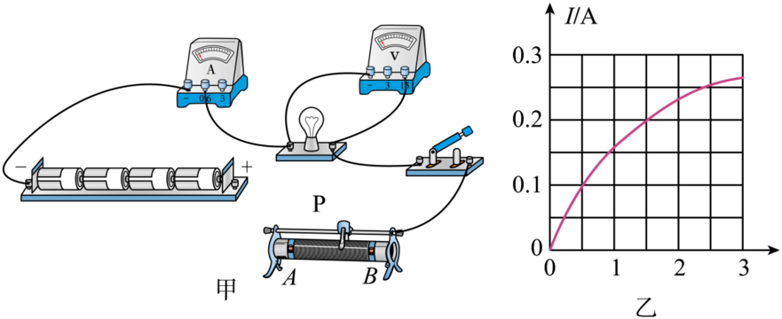

# Physics - 题目 2219

**ID**: 8d4b929648384c829e30fb1f21bee8f6
**年级**: Grade 9
**难度**: Medium
**题型**: Experiment

## 题目
在“测量小灯泡的额定功率”的实验中，晓铭发现小灯泡上的额定电压模糊不清，只能看清标有“0.25A”的字样，电源电压为6V保持不变。​​​​​​​‌（1）请用笔画线代替导线在图甲中补画一根导线，使得测量小灯泡电功率的电路完整，要求滑片P向B端移动时，小灯泡变亮。（2）正确连接电路后闭合开关，发现灯泡不亮，电流表无示数，电压表有示数，则电路的故障可能是（填选项符号）

## 解答

1. （1）滑动变阻器接右下接线柱B时，滑片向B端移动时，电路电阻变小，电流变大，灯泡两端电压变大，灯泡变亮；故电路图如图所示：
2. 
3. （2）电流表无示数，说明电路断路；又因为电压表有，说明电压表接在电源两端，因此电路故障为小灯泡断路。
4. （3）由于无论怎么样移动滑动变阻器，电压表指针偏转角度较小，说明电压表量程选择过大，所以应选择小量程。
5. （4）电路连接正确操作后，小灯泡发光，此时电流表的示数为0.2A，小于灯泡额定电流为0.25A，所以为了测量小灯泡的额定电功率，应减小滑动变阻器接入电阻，所以向B移动。
6. （5）由图可知，当电流为0.25A时，小灯泡两端电压为2.5V，由 $P=UI$ 可知，小灯泡的额定功率 $P=UI=2.5{\rm{V}}\times 0.25{\rm{A}}=0.625{\rm{W}}$ 。

## 知识点

**中文**:
  - 伏安法测量小灯泡的电功率

**English**:
  - Measuring Bulb Power (Voltammetry)

---
