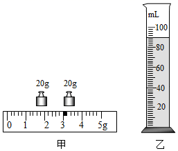
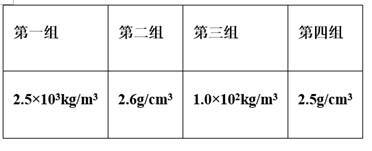

# Physics - 题目 2311

**ID**: 8f63ec56b8064a61a42a7f719e80feda
**年级**: Grade 9
**难度**: Medium
**题型**: Experiment

## 题目
如图，在“测量石块的密度”实验中:(1)小李同学首先用天平测出石块的质量，天平平衡时右盘砝码和游码位置如图甲所示，则石块的质量为g。​​​​​​​‌(2)为了测量出石块的体积，小李同学先往量筒中加入一定量的水，如图乙所示，他的操作合理吗?为什么?答：。(3)小石块投入水中后会沉到底部，说明小石块所受的浮力重力（选填“大于”、“小于”或“等于”）。(4)四个小组测量出的石块密度如下表所示：其中错误的是第组的测量结果。(5)对实验进行评估时，下列分析正确的是。

## 解答

1. (1)[1]小李同学首先用天平测出石块的质量，天平平衡时右盘砝码和游码位置如图甲所示，天平刻度盘读数为3g，2个20g砝码，则石块的质量为
2. m=20g+20g+3g=43g
3. (2)[2]为了测量出石块的体积，小李同学先往量筒中加入一定量的水，他的操作不合理，水太多，放入石块后有可能会溢出。
4. (3)[3]小石块投入水中后会沉到底部，说明小石块在竖直方向上，所受向上的浮力小于向下的重力。
5. (4)[4]四个小组测量出的石块密度中，第一、二、四组数据单位统一后结果一致或接近，而第三组数据明显偏低，应为错误数据。
6. (5)[5]砝码磨损后测出的质量偏大，故A错误；石块放在天平右盘，测出的质量不变，故B错误；先测石块体积，后测石块质量，石块上有水则质量测试结果偏大，即测出的密度偏大，故C错误、D正确。故选D。

## 知识点

**中文**:
  - 固体密度的测量实验

**English**:
  - Experiment: Measuring Density of Solids

---
