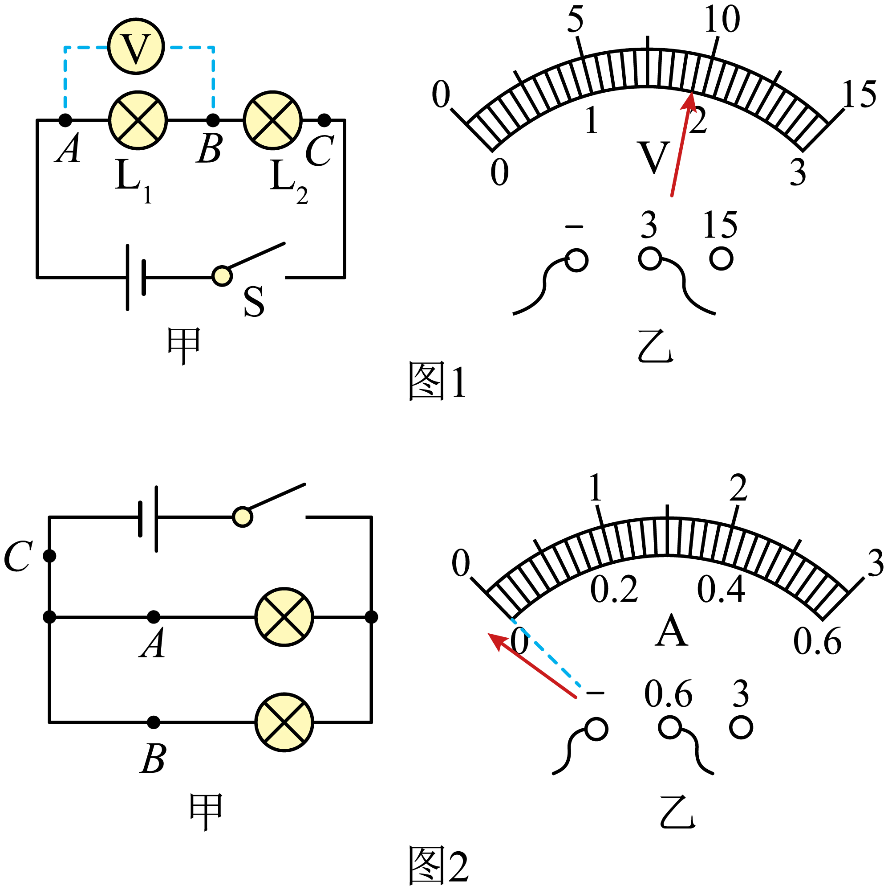

# Physics - 题目 2795

**ID**: 977912dfea1e4f6883a7038056d6b7cc
**年级**: Grade 9
**难度**: Medium
**题型**: Experiment

## 题目
爱动脑的小雨和喜欢动手实验的小畅同学一起探究串、并联电路中电流、电压的关系，她们设计的电路如图甲所示。​​​​​​​‌（一）小雨探究“串联电路电压规律”（1）连接电路时，电压表要与被测用电器联，应用法来选择量程；（2）小雨根据图1甲连接好电路，闭合开关后，发现L_{1}、L_{2}均不发光，电压表有示数且大小接近电源电压，则电路中出现的故障可能是L_{1}发生了（选填“短路”或“开路”）；（3）在某次测量时，电压表的示数如图1乙所示，此时灯泡L_{1}两端的电压为V；（4）实验中小雨应该选择规格（选填“相同”或“不相同”）的小灯泡，进行多次测量，其目的是。（二）小畅探究“并联电路电流规律”（5）小畅连接好电路后，在闭合开关瞬间，发现电流表的指针偏向如图2乙所示，你认为产生该现象的原因是；（6）小畅分析后很快排除了故障，把电流表分别接入到电路中的A、B、C处，测出它们的电流，见表：实验次数A处的电流I_{A}/AB处的电流I_{B}/AC处的电流I_{C}/A10.100.240.3420.200.260.4630.250.300.55根据小畅同学的实验数据，可得出的结论是：（写关系式即可）。

## 解答

1. （一）（1）连接电路时，电压表应并联在被测用电器两侧。
2. 为了保护电压表，我们采用用试触法来选择量程。
3. （2）由图1甲可知，两灯泡串联，电压表测L_{1}两端的电压；若L_{1}短路，电压表示数为0，电路为通路，L_{2}发光，不符合题意；若L_{1}断路，闭合开关S后，灯L_{1}、L_{2}均不发光，电压表与灯L_{2}串联在电路中，电压表测电源电压，电压表有示数，符合题意，故电路中出现的故障可能是L_{1}发生了断路。
4. （3）图1乙中电压表选用小量程，分度值为0.1V，示数为1.9V，因此此时灯L_{1}两端的电压为为1.9V。
5. （4）为了避免偶然性，使探究得出的结论具有得出普遍性的结论，实验中小畅应该选择规格规格不相同的小灯泡，进行多次测量。
6. （二）（5）连接好电路后，在闭合开关瞬间，发现电流表的指针偏向如图2乙所示，即电流表的指针向左侧偏转，说明电流从电流表的负接线柱流入，正接线柱流出，即电流表的正负接线柱接反了。
7. （6）由表中实验数据知 ${\rm{0}}{\rm{.}}{\rm{1}}{\rm{0}}{\rm{A}}{\rm{+}}{\rm{0}}{\rm{.}}{\rm{2}}{\rm{4}}{\rm{A}}{\rm{=}}{\rm{0}}{\rm{.}}{\rm{3}}{\rm{4}}{\rm{A}}$ ， ${\rm{0}}{\rm{.}}{\rm{2}}{\rm{0}}{\rm{A}}{\rm{+}}{\rm{0}}{\rm{.}}{\rm{2}}{\rm{6}}{\rm{A}}{\rm{=}}{\rm{0}}{\rm{.}}{\rm{4}}{\rm{6}}{\rm{A}}$ ， ${\rm{0}}{\rm{.}}{\rm{2}}{\rm{5}}{\rm{A}}{\rm{+}}{\rm{0}}{\rm{.}}{\rm{3}}{\rm{0}}{\rm{A}}{\rm{=}}{\rm{0}}{\rm{.}}{\rm{5}}{\rm{5}}{\rm{A}}$
8. 可以得出的结论 $I{{}_{C}}=I{{}_{A}}+I{{}_{B}}$

## 知识点

**中文**:
  - 探究串、并联电路中的电压规律实验
  - 探究串、并联电路的电流规律实验

**English**:
  - Experiment: Voltage Laws in Series/Parallel
  - Experiment: Current Laws in Series/Parallel

---
