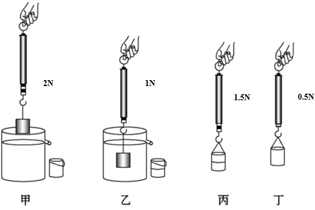

# Physics - 题目 1688

**ID**: 97a9d4e235614180b074438adb9d4526
**年级**: Grade 9
**难度**: Medium
**题型**: Experiment

## 题目
小红设计了如图所示的实验来探究“浮力的大小跟排开液体所受重力的关系”。​​​​​​​‌(1)实验的最佳顺序是。

## 解答

1. (1)[1]先测量空桶重力和物体的重力，将物体浸没在溢水杯中，测量拉力的大小，测量小桶和溢出水的重力，所以最佳顺序丁甲乙丙，故选B。
2. (2)[2][3]图甲中物体的重力是2N，图乙中物体在水中受到的拉力是1N，物体受到的浮力
3. F_{浮}=G-F=2N-1N=1N
4. 由图丁可知，空桶的重力为0.5N，图丙中桶和溢出水的总重力为1.5N，排开水的重力
5. G_{排}=G_{总}-G_{桶}=1.5N-0.5N=1N
6. 所以比较可知
7. F_{浮}=G_{排}
8. 即浸在液体中的物体，受到的浮力大小等于它排开液体的重力。
9. (3)[4]A．图乙中水面未到达溢水杯的溢水，排开水的重力小于所受的浮力，会影响实验结论。
10. B．图乙中物体未全部浸没在水中，排开水的重力减小，浮力减小，浮力和排开水的重力减小量相等，浮力等于排开液体的重力，不会影响实验结论。
11. (4)[5]将图乙中的水换成酒精，排开液体的体积不变，液体的密度变小，由F_{浮}=ρ_{液}gV_{排}可知物体受到的浮力变小。
12. (5)[6]探究“漂浮在液面上的物体所受浮力的大小是否遵循阿基米德原理”，图乙中物体处于漂浮状态，弹簧测力计的示数为零，不需要弹簧测力计。

## 知识点

**中文**:
  - 实验探究阿基米德原理

**English**:
  - Experiment: Investigating Archimedes' Principle

---
