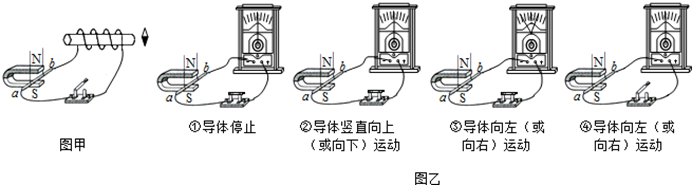

# Physics - 题目 905

**ID**: 980dd5b71e074c2aa29367224f1063ae
**年级**: Grade 9
**难度**: Medium
**题型**: Experiment

## 题目
在“探究什么情况下磁可以生电”的实验中：（1）小星设计的电路如图甲所示，在蹄形磁体的磁场中放置一根导线ab，ab的两端分别跟开关和螺线管连接，螺线管旁放置一个小磁针，当ab中产生电流时，螺线管中有通过，小磁针会发生偏转．（2）小星闭合开关后，不管导线ab在磁场中怎样运动，小磁针都不偏转，是没有产生电流，还是产生的电流太微弱？他换用了一个灵敏电流表代替螺线管和小磁针，如果灵敏电流表指针发生偏转，表明ab中产生电流，实验的情况如图乙所示。​​​​​​​‌

## 解答

1. (1)[1]当导体ab中产生电流时，螺线管中有电流通过，螺线管周围形成磁场，小磁针受磁力作用会发生偏转。
2. (2)图乙中的电路都是闭合电路，而产生感应电流的条件时闭合电路的一部分导体做切割磁感线运动。
3. A. [2][3][4]导体静止时，没有做切割磁感线运动，不能产生感应电流；导体沿着磁感线方向运动时，没有做切割磁感线运动，不能产生感应电流；导体切割磁感应线运动时，能产生感应电流。
4. B.[5]观察并分析③④现象可知，③是闭合电路，④的电路没有闭合，所以产生感应电流的条件之一是闭合电路。
5. (3)[6]对比图甲和图乙两次实验后，图甲中是闭合电路且ab切割磁感线运动了，而小磁针不发生偏转，不是没有产生电流，而是产生的电流太微弱。

## 知识点

**中文**:
  - 探究电磁感应现象的实验

**English**:
  - Experiment: Electromagnetic Induction

---
