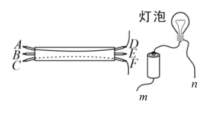

# Physics - 题目 765

**ID**: 993825ea54c448fb93af3979227be4d8
**年级**: Grade 9
**难度**: Medium
**题型**: Experiment

## 题目
如图，在硬塑料管内穿有三根完全相同的电线，A、B、C三个线头与D、E、F三个线头连通，但未知哪两个线头属同一根导线，想验证C、D线头是否属同一根导线。​​​​​​​‌（1）请连接图中的器材组成电路；（2）若观察到现象，说明两线头为同一根导线的两端。

## 解答

1. （1）[1]想验证C、D线头是否属同一根导线，需要将C、D接入电路中，将导线m连接D线头，将导线n连接C线头，如图所示：
2. 
3. （2）[2]若小灯泡发光，则CD连通，由此可以确定C、D线头为同一根导线的两端。

## 知识点

**中文**:
  - 电路的组成与连接

**English**:
  - Components and Connection of Circuits

---
