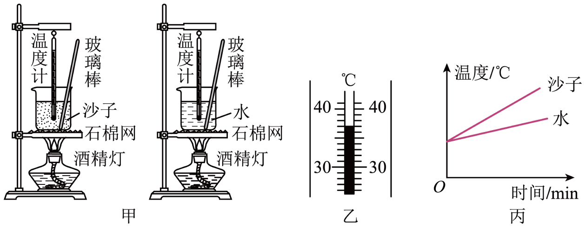

# Physics - 题目 301

**ID**: 9ca0be6ff3a94ef29bdce2521b4505a6
**年级**: Grade 9
**难度**: Medium
**题型**: Experiment

## 题目
小明利用如图甲所示的实验装置探究沙子和水的温度变化与吸热的关系。​​​​​​​‌操作如下：（1）在两烧杯中分别装入初始温度相同且相等的沙子和水；（2）用相同的酒精灯火焰加热，并用玻璃棒不断搅拌，每隔相同的时间记录一次温度，其中某时刻的温度如图乙所示，其示数为℃。根据实验数据绘制成温度与时间的关系图象，如图丙所示；（3）实验中，是通过比较来间接反映沙子和水吸收热量的多少；（4）分析图象可知，沙子和水吸收相同热量时，温度升高较多的是；若使两者升高相同的温度，则吸收的热量较多。由此可见，的比热容较大。

## 解答

1. （1）在两烧杯中分别装入初始温度相同且质量相同的沙子和水，才能比较不同物质的吸热能力。
2. （2）用相同的酒精灯火焰加热，并用玻璃棒不断搅拌，每隔相同的时间记录一次温度，其中某时刻的温度如图乙所示，分度值为1℃，故其示数为37℃。
3. （3）实验中，是通过比较加热时间来反应吸收热量多少，因为相同规格的酒精灯在相同的时间内放出的热量相同。
4. （4）如图丙加热时间相同，吸收的热量相同，沙子的温度升高较多；若使两者升高相同的温度，水需要加热更长的时间，故水需要吸收的热量多；由 $c=\frac {Q}{m�t}$ 可知，水的比热容大。

## 知识点

**中文**:
  - 物质的比热容探究实验

**English**:
  - Experiment: Investigating Specific Heat Capacity

---
