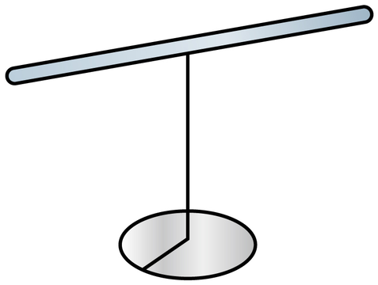

# Physics - 题目 2236

**ID**: 9d51d34ab4ab4efd99ec390cd3db3c25
**年级**: Grade 9
**难度**: Medium
**题型**: Experiment

## 题目
如图所示，用一段细铁丝做一个支架，作为转动轴，把一根中间戳有小孔（没有戳穿）的饮料吸管放在转动轴上，吸管能在水平面内自由转动。​​​​​​​‌用餐巾纸摩擦吸管使其带电。（1）把某个物体放在带电吸管一端的附近，发现吸管向物体靠近，由此现象我们（选填“能”或“不能”）判断该物体已经带电；（2）把丝绸摩擦过的玻璃棒放在带电吸管一端的附近，吸管被吸引，说明吸管带电，吸管被吸的原因是；（3）吸管和餐巾纸摩擦起电时，（选填“吸管”或“餐巾纸”）中原子核束缚电子的本领弱一些。

## 解答

1. （1）带电体除了吸引带有异种电荷的物体外，还可以吸引不带电的轻小物体，所以不能判定物体是否带电。
2. （2）丝绸摩擦过的玻璃棒带正电，带电吸管与它相互吸引，由于异种电荷相互吸引可知，吸管带负电荷。
3. （3）摩擦起电的实质是电子的转移，用餐巾纸摩擦吸管，使吸管带负电，说明吸管得到电子，吸管中原子核束缚电子的能力强一些，餐巾纸中原子核束缚电子的本领弱一些。

## 知识点

**中文**:
  - 摩擦起电的实质

**English**:
  - Nature of Triboelectricity

---
