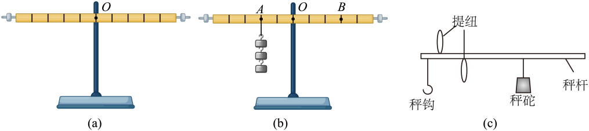

# Physics - 题目 200

**ID**: 9dea679f3f0c4af29d08fa067bf39ad7
**年级**: Grade 9
**难度**: Medium
**题型**: Experiment

## 题目
小鹏利用铁架台、杠杆、质量相等的钩码等器材，探究杠杆的平衡条件。​​​​​​​‌（1）调节螺母，将没挂钩码的杠杆调节至水平位置平衡，如图（a）所示，其目的是方便测量；（2）如图（b）所示，在A处挂3个钩码，则应在B处挂个钩码，才能使杠杆在水平位置保持平衡；（3）凝聚华夏智慧的杆秤是杠杆平衡条件的一个应用，杆秤由带有秤星的秤杆、秤砣、提纽等组成，如图（c）所示，此杆秤有两个提纽，使用它称较重的物体时，常用离秤钩较（选填“近”或“远”）的提纽。

## 解答

1. （1）当杠杆在水平位置平衡时，力的方向与杠杆垂直，力臂等于支点到力的作用线的距离，力臂可以从杠杆标尺刻度上直接读出来，便于测量力臂的大小。
2. （2）设一个钩码的重力为G，一个的距离为L，根据杠杆平衡条件可得 $3G\times 2L=F{{}_{B}}\times 3L$ ，解得 $F{{}_{B}}=2G$ ，因此应在B处挂2个钩码。
3. （3）使用杆秤称量较重的物体时，物体的重力变大，在秤砣的重力不变的情况下，根据杠杆的平衡条件可知，需要增大秤砣重力的力臂、减小物体重力的力臂，所以用离秤钩较近的提纽。

## 知识点

**中文**:
  - 探究杠杆的平衡条件实验

**English**:
  - Experiment: Equilibrium Conditions of Levers

---
