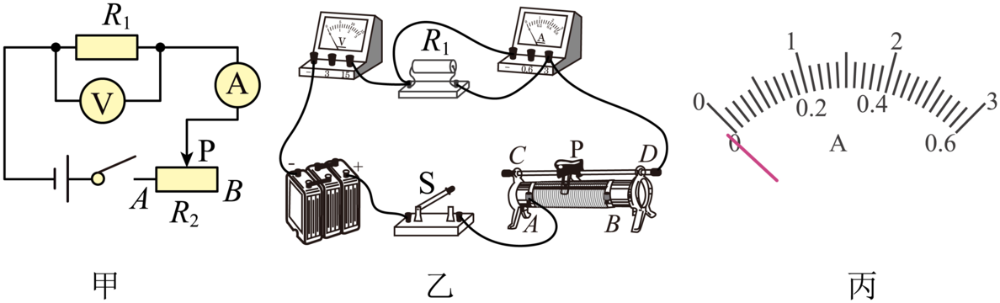

# Physics - 题目 2399

**ID**: 9df0e567bedc4733ac28b587ade70eb9
**年级**: Grade 9
**难度**: Medium
**题型**: Experiment

## 题目
在“探究电流与电压、电阻的关系”实验中：（1）小敏同学按甲图的电路原理图连接了乙图实物电路，其中有两个元件连接错误。​​​​​​​‌它们分别是和（只需填写连错的元件）；（2）重新连接电路后，用开关S进行试触，如果电流表指针如图丙所示，说明电流表；如果电流表指针向右偏转超过刻度盘，应换用量程；（3）正确连接电路后，测出 $R{{}_{1}}=5Ω$ 、两端电压为3V时的电流，并记录相关数据。然后将电阻R_{1}由5Ω换成10Ω，此时他应将滑动变阻器触头P向端滑动（选填“A”或“B”），在触头P滑动的过程中他的眼睛应始终注视着（选填“电压表”或“电流表”），使电阻R_{1}两端的电压为V时为止。

## 解答

1. （1）由图可知，电压表应该与电阻并联，电流表应该与电阻串联，它把电流表和电压表的位置接反了。
2. （2）用开关S进行试触，如图丙，电流表指针向左偏转，说明电流表的正负接线柱接反了；如果向右偏转超过刻度盘，说明电流表的量程选择过小，应换用大量程重新测量。
3. （3）探究电流与电阻关系，应控制电压不变，保持3V，将定值电阻由5Ω换成10Ω，总电阻变大，总电压不变，所以电流变小，滑动变阻器电阻不变，根据 $U=IR$ ，滑动变阻器两端电压变小，总电压不变，由串联电压规律 $U=U{{}_{1}}+U{{}_{2}}$ 可知，电阻两端电压变大，电压表示数变大；要使电压表示数仍为3V，需要将电压表示数变小，定制电阻阻值不变，根据 $I=\frac {U}{R}$ ，需要将电路中电流变小，滑动变阻器接入电阻变大，由图甲可知，滑片需要向B端移动，同时眼睛要注视电压表，直到电压表示数变成3V。

## 知识点

**中文**:
  - 电流与电阻关系的探究实验

**English**:
  - Experiment: Relationship between Current and Resistance

---
