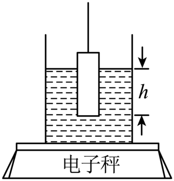

# Physics - 题目 2138

**ID**: a3cf4105dac3435daaf22413233c9618
**年级**: Grade 9
**难度**: Medium
**题型**: Experiment

## 题目
如图所示为“探究浮力大小与哪些因素有关”的实验装置。​​​​​​​‌实验过程如下：先将盛有盐水的容器放在电子秤上，然后用手提着系有细线的圆柱体将其缓缓的浸入盐水中（盐水足够深），同时记下圆柱体下表面所处的深度h和电子秤显示的相应的质量m，记录数据如下表所示。已知圆柱体的高度为15cm，当h=8cm时，用弹簧秤测得细线对圆柱体的拉力为1.2N。h/cm024681012……m/kg2.0002.0402.0802.1202.1602.2002.240……（1）实验过程中，电子秤示数逐渐增大时，细线对圆柱体的拉力逐渐（填“增大”或“减小”）；（2）当h=8cm时，圆柱体受到的浮力大小为（填“21.6”或“1.6”）N。分析表中数据可知：圆柱体受到的浮力大小与浸入盐水的体积成比；（3）圆柱体的密度与盐水的密度之比为。

## 解答

1. （1）[1]实验过程中，电子秤示数逐渐增大时，则说明圆柱体下表面所处的深度h增大，圆柱体排开液体的体积增大，故浮力增大，圆柱体受到了重力和拉力和浮力，细绳对圆柱体的拉力为
2. $F=G-F{{}_{浮}}$
3. 浮力慢慢变大，故绳子对圆柱体的拉力减小。
4. （2）[2]当h=8cm时，电子秤显示的相应的质量2.16kg，对比h为0cm，弹簧秤显示的示数为2kg，故增加了的质量为
5. $Δm{\rm{=}}m{{}_{1}}-m{{}_{0}}{\rm{=}}2{\rm{.}}16{\rm{k}}{\rm{g}}-2{\rm{k}}{\rm{g}}{\rm{=}}0{\rm{.}}{\rm{1}}{\rm{6}}{\rm{k}}{\rm{g}}$
6. 则电子秤增加的压力为
7. $ΔF{\rm{=}}Δmg{\rm{=}}0{\rm{.}}{\rm{1}}{\rm{6}}{\rm{k}}{\rm{g}}\times {\rm{1}}{\rm{0}}{\rm{N}}{\rm{/}}{\rm{k}}{\rm{g}}{\rm{=}}{\rm{1}}{\rm{.}}{\rm{6}}{\rm{N}}$
8. 将水当成一个整体，这个整体受到了圆柱体对其的压力为1.6N，而水对圆柱体的力也是1.6N，而水对圆柱体的力是浮力，故浮力的大小为1.6N。
9. [3]分析表中数据可知，没有浸没前，电子秤增加的示数是圆柱体下表面所处的深度的两倍，底面积固定，则电子秤增加的示数与圆柱体的排开液体的体积成正比，而电子秤增加的压力即为浮力，故圆柱体受到的浮力大小与浸入盐水的体积成正比。
10. （3）[4]当h=8cm时，圆柱体所受的浮力为1.6N，此时用弹簧秤测得细线对圆柱体的拉力为1.2N，则圆柱体的重力为
11. $G=F+F{{}_{浮}}=1.2{\rm{N}}{\rm{+}}1{\rm{.}}6{\rm{N}}{\rm{=}}2{\rm{.}}8{\rm{N}}$
12. 设圆柱体的底面积为S，则圆柱体的密度为
13. $ρ{{}_{圆}}=\frac {m{{}_{圆}}}{V{{}_{圆}}}{\rm{=}}\frac {\frac {G}{g}}{S\times h{{}_{圆}}}{\rm{=}}\frac {G}{Sgh{{}_{圆}}}$
14. 当h=8cm时，圆柱体所受的浮力为1.6N，则盐水的密度为
15. $ρ{{}_{盐水}}{\rm{=}}\frac {F{{}_{浮}}}{V{{}_{排}}g}=\frac {F{{}_{浮}}}{Sgh}$
16. 圆柱体的密度与盐水的密度之比为
17. $\frac {ρ{{}_{圆}}}{ρ{{}_{盐水}}}=\frac {\frac {G}{Sgh{{}_{圆}}}}{\frac {F{{}_{浮}}}{Sgh}}{\rm{=}}\frac {2{\rm{.}}8{\rm{N}}}{1{\rm{.}}6{\rm{N}}}\times \frac {h}{h{{}_{圆}}}{\rm{=}}\frac {2{\rm{.}}8{\rm{N}}}{1{\rm{.}}6{\rm{N}}}\times \frac {8{\rm{c}}{\rm{m}}}{15{\rm{c}}{\rm{m}}}{\rm{=}}\frac {14}{15}$

## 知识点

**中文**:
  - 探究影响浮力大小因素的实验

**English**:
  - Experiment: Factors Affecting Buoyancy

---
