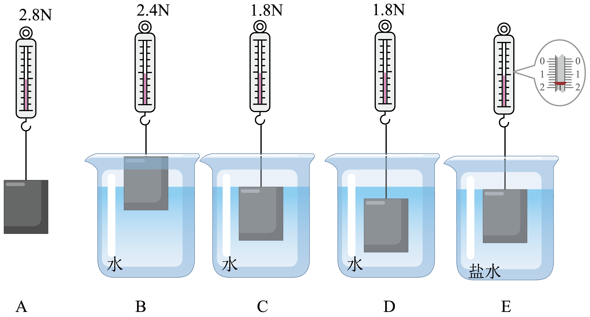
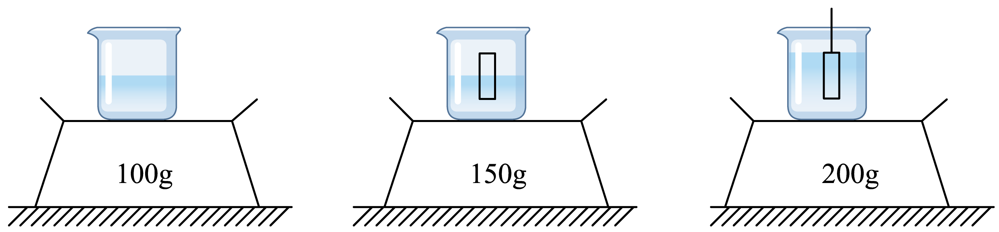

# Physics - 题目 755

**ID**: ba45b914e551485e9891294f9d0187ea
**年级**: Grade 9
**难度**: Medium
**题型**: Experiment

## 题目
小明同学用一个弹簧测力计、一个金属块、两个相同的烧杯（分别装有一定量的水和盐水），对浸在液体中的物体所受的浮力进行了探究，探究过程及有关数据如图所示。​​​​​​​‌（1）金属块浸没在水中所受的浮力是N。（2）观察A、B、C可得出金属块受到的浮力大小与有关。比较A、C、E可知浮力大小还与有关。比较A、C、D可知浮力大小与物体浸没在液体中的无关。（3）根据实验测得的数据还可以计算出盐水的密度为ρ_{盐}_{水}=kg/m^{3}；（4）为了使实验现象更明显，在满足条件的情况下，所选金属块的体积应选（选填“较小”或“较大”）。（5）吉吉同学受上面实验的启发，用家里的电子秤、玻璃杯、木块、水、细线，进行了如图所示的操作。①装有适量水的杯子放在电子秤上；②然后让木块自由漂浮在水面上：③最后用细针将木块压入水中刚好全部浸没（水未溢出）。吉吉利用图中的这些数据计算出木块的密度为g/cm^{3}，爱思考的彪彪认为木块浸入水中后会吸水（木块吸水后不考虑其体积变化），所以吉吉测得的木块密度值应该比真实值（选填“偏大”、“偏小”或“无影响”）。

## 解答

1. （1）[1]金属块浸没在水中所受的浮力为
2. F_{浮}=G-F_{示}=2.2N-1.8N=1N
3. （2）[2]观察A、B、C，随着排开液体体积的增大，弹簧测力计的示数在减小，则浮力在逐渐变大，可得出金属块受到的浮力大小与液体的体积有关。
4. [3]比较A、C、E，排开液体体积相同时，液体的密度越大，弹簧测力计的示数越小，则浮力越大，可知浮力大小还与液体的密度有关。
5. [4]比较A、C、D，液体密度和排开液体的体积相同时，浸入的深度不同，弹簧测力计的示数相同，说明受到的浮力相同，可知浮力大小与物体浸没在液体中深度无关。
6. （3）[5]金属块的体积为
7. $V=V{{}_{水排}}=\frac {F{{}_{水浮}}}{ρ{{}_{水}}g}=\frac {1{\rm{N}}}{1.0\times 10{^{3}}kg/{\rm{m}}{^{3}}\times 10{\rm{N}}/kg}=1\times 10{^{-4}}{\rm{m}}{^{3}}$
8. 盐水的密度为
9. $ρ{{}_{盐水}}=\frac {F{{}_{盐水浮}}}{gV{{}_{排}}}=\frac {G-F{{}_{{\rm{E}}}}}{gV{{}_{排}}}=\frac {2.8{\rm{N}}-1.6{\rm{N}}}{10{\rm{N}}/kg\times 1\times 10{^{-4}}{\rm{m}}{^{3}}}=1.2\times 10{^{3}}kg/{\rm{m}}{^{3}}$
10. （4）[6]选较大体积的金属块，排开液体的体积较大，受到的浮力较大，实验现象更明显。
11. （5）[7]木块的质量为
12. m_{木}=m_{2}-m_{1}=150g-100g=50g
13. 木块的体积等于排开水的体积为
14. $V{{}_{木排}}=\frac {m{{}_{水排}}}{ρ{{}_{水}}}=\frac {m{{}_{3}}-m{{}_{1}}}{ρ{{}_{水}}}=\frac {200{\rm{g}}-100{\rm{g}}}{1{\rm{g}}/cm{^{3}}}=100cm{^{3}}$
15. 木块的密度为
16. $ρ{{}_{木}}=\frac {m{{}_{木}}}{V{{}_{木}}}=\frac {50{\rm{g}}}{100cm{^{3}}}=0.5{\rm{g}}/cm{^{3}}$
17. [8]木块浸入水中吸水后，体积不变，排开水的质量不变，而玻璃杯和水（减小）的总质量变小，第三图中电子秤的示数偏小，即体积偏小，密度偏大。

## 知识点

**中文**:
  - 探究影响浮力大小因素的实验
  - 特殊方法测密度

**English**:
  - Experiment: Factors Affecting Buoyancy
  - Special Methods for Measuring Density

---
