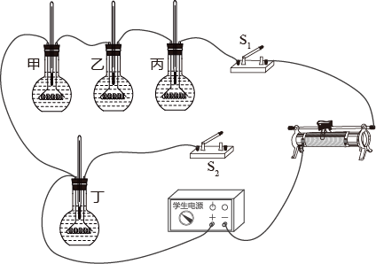

# Physics - 题目 2660

**ID**: bcfda9e43f184198a9cab41ff5339036
**年级**: Grade 9
**难度**: Medium
**题型**: Experiment

## 题目
如图所示，这是探究“电流产生热量的影响因素”的实验电路。​​​​​​​‌在完全相同的烧瓶中装入质量相等、初温相同的煤油，用电阻丝加热，其中R_{甲}>R_{乙}>R_{丙}，R_{丙}=R_{丁}。通过观察插入密封烧瓶里的细玻璃管中煤油液柱上升的高度，就可以比较电阻丝放热的多少。请你按照要求，回答下列问题：（1）探究环节一：探究“电流产生热量的多少与电流大小有无关系”时，闭合开关S_{1}、S_{2}，在相同时间内，对比烧瓶和烧瓶中煤油液柱上升的高度即可。（2）探究环节二：探究“电流产生热量的多少与电阻大小的关系”时，当闭合S_{1}、断开S_{2}时。发现在相同时间内，甲、乙、丙烧瓶中煤油液柱上升的高度关系是 $h{{}_{甲}}>h{{}_{乙}}>h{{}_{丙}}$  ，由此得出的结论是：（3）生活中，我们发现一些利用电流热效应工作的大功率电热器连接线都比较粗，电热器内部的发热体温度很高（发热体可以认为是一个定值电阻），连接它的导线并不是很热，此现象可以用探究环节（选填“一”或“二”）得到的结论来解释。

## 解答

1. （1） 探究“电流产生热量的多少与电流大小有无关系”时，要控制电阻大小相同，改变电阻的电流，比较电阻产生的热量的多少。从电路图中可以看出，闭合开关S_{1}、S_{2}，甲乙丙串联后再与丁并联，甲乙丙电路的总电阻为 $R=R{{}_{甲}}+R{{}_{乙}}+R{{}_{丙}}>R{{}_{丁}}$ ，甲乙丙的总电压U_{1}等于丁的电压U_{2}等于电源电压U，由 $I=\frac {U}{R}$ ，得，甲乙丙的电流比丁的电流小，所以探究“电流产生热量的多少与电流大小有无关系”时，闭合开关S_{1}、S_{2}，在相同时间内，对比丙烧瓶和丁烧瓶中煤油液柱上升的高度即可。
2. （2） 探究“电流产生热量的多少与电阻大小的关系”时，应控制电阻的电流相同，使研究电阻的电阻大小不同，观察研究电阻产生的热量的多少。当闭合S_{1}、断开S_{2}时，甲乙丙串联，丁断路不工作，所以甲乙丙的电流大小相等。发现在相同时间内，甲、乙、丙烧瓶中煤油液柱上升的高度关系是 $h{{}_{甲}}>h{{}_{乙}}>h{{}_{丙}}$ ，说明甲产生的热量大于乙产生的热量大于丙产生的热量，因此可得结论：当电流大小相同时，电阻越大，电流产生的热量越多。
3. （3） 大功率电热器连接线都比较粗，长度相同时，横截面积越大，电阻越小。大功率电热器连接线都比较粗，说明连线的电阻比较小，而大功率电热器与连线串联，说明电热器与导线的电流相同。电热器内部的发热体温度很高（发热体可以认为是一个定值电阻），连接它的导线并不是很热，说明电热器产生的热量比连线大，故说明电流产生的热量与电阻大小有关，此现象可以用探究环节二得到的结论来解释。

## 知识点

**中文**:
  - 影响电流热效应因素的探究实验

**English**:
  - Experiment: Factors Affecting Heating Effect

---
