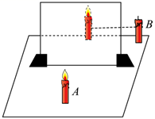

# Physics - 题目 2746

**ID**: c19703274ce04ad596548555ad0357f9
**年级**: Grade 9
**难度**: Medium
**题型**: Experiment

## 题目
小刚同学在做“探究平面镜成像”的实验时，将一块玻璃板架在水平实验台上，如图所示。​​​​​​​‌(1)为准确找到像的位置，玻璃板应选用较薄的玻璃，并且应保证立在水平实验台上；(2)实验中取两段完全相同的蜡烛A 和 B，如图所示。点燃玻璃板前的蜡烛A，并移动蜡烛B放在所看到的蜡烛A的像的位置，进行观察。在此实验中：选取两段完全相同的蜡烛是为了比较关系。

## 解答

1. (1)[1]透明的薄玻璃板要竖直放置在水平台上，保证透明的玻璃板要和水平台垂直，像在水平台上，便于玻璃板后面的蜡烛和玻璃板前面蜡烛的像重合。
2. (2)[2]实验时采用两个完全相同的蜡烛，当玻璃板后面的蜡烛和玻璃板前面的蜡烛的像完全重合时，可以确定像的位置，同时也可以比较像和物大小关系。

## 知识点

**中文**:
  - 平面镜成像特点的探究实验

**English**:
  - Experiment: Characteristics of Plane Mirror Imaging

---
