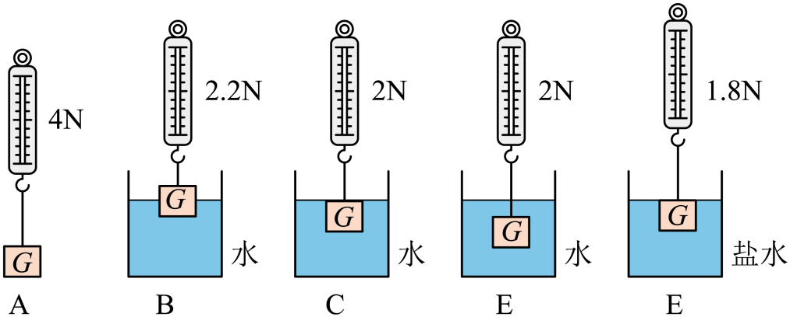

# Physics - 题目 757

**ID**: c1bb5dac90a54b838c6f16589aa1efc5
**年级**: Grade 9
**难度**: Medium
**题型**: Experiment

## 题目
如图所示是小明探究浮力实验的过程：（1）通过上图实验可知：圆柱体浸没在盐水中时所受浮力为N；（2）比较C、D两图能说明浮力的大小与浸没在液体的深度，本实验主要用到的实验方法是；（3）由图中的信息可算出物体的密度为g/cm^{3}，盐水的密度为kg/m^{3}；（4）如图所示图像，能正确反映弹簧测力计示数F与圆柱体下表面与水面距离h的关系的图像是。​​​​​​​‌

## 解答

1. （1）根据AE两图和称重法可得，圆柱体浸没在盐水中时所受浮力 $F{{}_{浮盐水}}{\rm{=}}G{{-}}F{{}_{{\rm{E}}}}{\rm{=}}{{4}}{\rm{N}}{{-}}{{1}}{{.}}{{8}}{\rm{N}}{\rm{=}}{{2}}{{.}}{{2}}{\rm{N}}$ 。
2. （2）比较C、D两图可知，控制液体的密度和排开液体的体积不变，深度改变，测力计的示数不变，圆柱体受到的浮力不变，说明浮力的大小与浸没在液体的深度无关，实验中采用的研究方法是控制变量法。
3. （3）由AD两图可知，物体浸没在水中时受到的浮力 $F{{}_{浮水}}{\rm{=}}G{{-}}F{{}_{{\rm{D}}}}{\rm{=}}{{4}}{\rm{N}}{{-}}{{2}}{\rm{N}}{\rm{=}}{{2}}{\rm{N}}$ ，因为圆柱体完全浸没在水中，根据阿基米德原理可得，物体的体积 $V{\rm{=}}V{{}_{排}}{\rm{=}}\frac {F{{}_{浮水}}}{ρ{{}_{水}}g}{\rm{=}}\frac {{{2}}{\rm{N}}}{{{1}}\times {{1}}{{0}}{^{{{3}}}}{\rm{k}}{\rm{g}}{\rm{/}}{\rm{m}}{^{{{3}}}}\times {{1}}{{0}}{\rm{N}}{\rm{/}}{\rm{k}}{\rm{g}}}{\rm{=}}{{2}}\times {{1}}{{0}}{^{{{-}}{{4}}}}{\rm{m}}{^{{{3}}}}$ ，根据 $G=mg$ 可得，物体的质量 $m{\rm{=}}\frac {G}{g}{\rm{=}}\frac {{{4}}{\rm{N}}}{{{1}}{{0}}{\rm{N}}{\rm{/}}{\rm{k}}{\rm{g}}}{\rm{=}}{{0}}{{.}}{{4}}{\rm{k}}{\rm{g}}$ ，物体的密度 $ρ=\frac {m}{V}{\rm{=}}\frac {{{0}}{{.}}{{4}}{\rm{k}}{\rm{g}}}{{{2}}\times {{1}}{{0}}{^{{{-}}{{4}}}}{\rm{m}}{^{{{3}}}}}{\rm{=}}{{2}}\times {{1}}{{0}}{^{{{3}}}}{\rm{k}}{\rm{g}}{\rm{/}}{\rm{m}}{^{{{3}}}}{\rm{=}}{{2}}{\rm{g}}{\rm{/}}{\rm{c}}{\rm{m}}{^{{{3}}}}$ ，盐水的密度 $ρ{{}_{盐水}}{\rm{=}}\frac {F{{}_{浮盐水}}}{gV{{}_{排}}}{\rm{=}}\frac {F{{}_{浮盐水}}}{Vg}{\rm{=}}\frac {{{2}}{{.}}{{2}}{\rm{N}}}{{{2}}\times {{1}}{{0}}{^{{{-}}{{4}}}}{\rm{m}}{^{{{3}}}}\times {{1}}{{0}}{\rm{N}}{\rm{/}}{\rm{k}}{\rm{g}}}{\rm{=}}{{1}}{{.}}{{1}}\times {{1}}{{0}}{^{{{3}}}}{\rm{k}}{\rm{g}}{\rm{/}}{\rm{m}}{^{{{3}}}}$ 。
4. （4）当圆柱体在完全浸没在水中之前，圆柱体下表面与水面距离增大时，圆柱体排开水的体积变大，受到水的浮力变大，根据称重法可知，圆柱体受到的测力计的拉力变小，即弹簧测力计的示数变小；当圆柱体完全浸没在水中后，深度变大，圆柱体排开水的体积不变，受到的浮力不变，根据称重法可知，圆柱体受到测力计的拉力不变，即弹簧测力计的示数不变，故C符合题意，ABD不符合题意。

## 知识点

**中文**:
  - 探究影响浮力大小因素的实验

**English**:
  - Experiment: Factors Affecting Buoyancy

---
