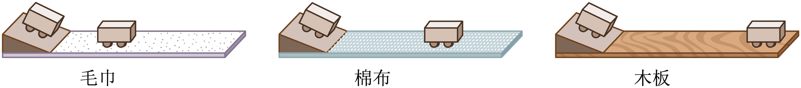

# Physics - 题目 742

**ID**: c2029523e7ec4abd8f530d9c645ad129
**年级**: Grade 9
**难度**: Medium
**题型**: Experiment

## 题目
小宁在探究“阻力对物体运动的影响”实验时，先后在水平桌面铺上粗糙程度不同的毛巾、棉布、木板做了三次实验，实验现象如图所示，则：（1）运动的小车在水平面上滑行距离的长短除了与小车受到的摩擦阻力有关外，你认为还应该与有关。​​​​​​​‌（2）探究阻力对运动小车的影响时，改变水平面的粗糙程度，让小车从斜面的（选填“相同”或“不同”）高度且静止滑下的目的是。（3）实验现象是：平面粗糙程度越小，小车受到的阻力越，滑行的距离越远。（4）该实验结果不能证明或推理下列的（      ）结论。

## 解答

1. （1）运动的小车在水平面上滑行距离的长短除了与小车受到的摩擦阻力有关外，还与下滑高度有关，因为在其它条件相同的情况下，下滑高度越高，小车到达水平面时的速度越大，小车在同一水平面运动的距离越长。
2. （2）根据控制变量法，探究阻力对运动小车的影响时，需要改变水平面的粗糙程度，但必须让小车从斜面的同一高度且静止滑下，目的是让小车到达水平面上时具有相同的初速度。
3. （3）小车对水平面的压力相同，平面粗糙程度越小，小车受到的摩擦力越小，速度减小慢，滑行的距离越远。
4. （4）A．在该实验结果的基础上，进一步推理可以得到牛顿第一定律，故A不符合题意；
5. B．该实验结果推理得出的结论是物体的运动不需要力的作用，故B符合题意；
6. C．物体在水平面上受到阻力的作用，速度逐渐减小，说明力可以改变物体的运动状态，故C不符合题意。

## 知识点

**中文**:
  - 阻力对物体运动影响的探究实验

**English**:
  - Experiment: Effect of Resistance on Motion

---
