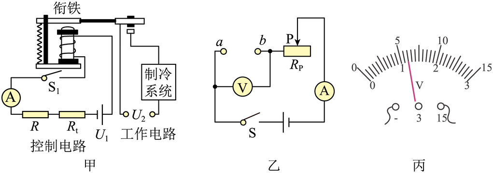

# Physics - 题目 2413

**ID**: c952e646b5e54e0fb59b53ea51cd8450
**年级**: Grade 9
**难度**: Medium
**题型**: Experiment

## 题目
电动车在充电过程中，电池温度过高可能会自燃。​​​​​​​‌为避免电池温度过高，某项目小组设计了如图甲所示的“自动制冷装置”。控制电路的电源电压 $U{{}_{1}}$ 恒为9V，当控制电路中的电流 $I⩾30{\rm{m}}{\rm{A}}$ 时，衔铁被吸下。为使温度升高至设定温度时，制冷系统开始启动，需要选择与电磁继电器匹配的定值电阻R和热敏电阻 $R{{}_{t}}$ 等器材。（1）在选择定值电阻时需要先测量定值电阻的阻值。将四个待测电阻依次接在图乙所示电路的a、b之间进行测量。①测量的原理是；②将 $R{{}_{1}}$ 接到a、b之间，当滑片移动到某位置时，电压表示数如图丙所示，电流表示数为0.2A，则定值电阻 $R{{}_{1}}$ 的阻值为Ω；按同样的方法测得 $R{{}_{2}}、R{{}_{3}}、R{{}_{4}}$ 阻值分别为90Ω、225Ω、240Ω；（2）选择符合条件的热敏电阻和定值电阻。①热敏电阻的阻值随温度变化的关系如下表所示，则应选用热敏电阻（ $R{{}_{t1}}$ / $R{{}_{t2}}$ ）；t/℃2030405060708090$R{{}_{t1}}/\Omega $200125907570626059$R{{}_{t2}}/\Omega $25304560105170290310②充电过程中当电池温度达到50℃时，衔铁被吸下，工作电路的制冷系统开始启动，则应选择的定值电阻是（ $R{{}_{1}}$ / $R{{}_{2}}$ / $R{{}_{3}}$ / $R{{}_{4}}$ ），此时电磁铁的上端为极。

## 解答

1. （1）实验中需要利用电压表测量电压，电流表测量电路中的电流，结合 $R=\frac {U}{I}$ 计算得出待测电阻的阻值，因此测量电阻的实验原理是 $R=\frac {U}{I}$ 。
2. 丙图中电压表选择的是大量程，分度值是0.5V，读数为6V，则定值电阻 $R{{}_{1}}$ 的阻值为 $R{{}_{1}}=\frac {U{{}_{1}}}{I{{}_{1}}}=\frac {6{\rm{V}}}{0.2{\rm{A}}}=30{\rm{Ω}}$
3. （2）根据题意，当温度升高至设定温度时，制冷系统开始启动，即衔铁被吸下，工作电路工作，说明控制电路中的电阻变小，电流变大，电磁铁的磁性增强，因此热敏电阻的阻值是随温度的升高而减小，则应选用热敏电阻R_{t}_{1}。
4. 当温度为50℃时，热敏电阻的阻值为75Ω，此时控制电路中的电流为 $30mA=0.03{\rm{A}}$
5. 控制电路中的总电阻为 $R{{}_{总}}=\frac {U}{I}=\frac {9{\rm{V}}}{0.03{\rm{A}}}=300{\rm{Ω}}$
6. 则定值电阻的阻值为 $R=R{{}_{总}}-R{{}_{t1}}=300{\rm{Ω}}-75{\rm{Ω}}=225{\rm{Ω}}$
7. 则应选择的定值电阻是R_{3}。
8. 甲图中电磁铁上的电流向左，根据安培定则可知，电磁铁上端为S极。

## 知识点

**中文**:
  - 与欧姆定律有关的动态电路计算
  - 电磁继电器的常见应用
  - 安培定则及其应用

**English**:
  - Calculations in Dynamic Circuits using Ohm's Law
  - Common Applications of Electromagnetic Relays
  - Ampere's Rule and Applications

---
