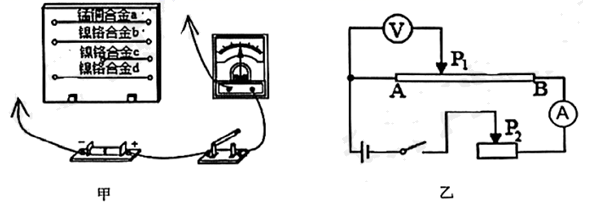

# Physics - 题目 1532

**ID**: d0a20336267e4ed0a7fe6cac3f7737df
**年级**: Grade 9
**难度**: Medium
**题型**: Experiment

## 题目
学习电学知识后，同学们利用手中的器材做了一系列相关实验来巩固学习成果。​​​​​​​‌如图甲所示，是小田同学探究影响导体电阻大小因素的实验装置图，实验中分别把a、b、c、d四根导线接入电路，其中导线a、b、d长度相同，a、b、c粗细相同，b、d粗细不同。(1)选用a、b两根导线分别接入电路中进行实验，是为了探究电阻大小跟导体的的关系；(2)选用两根导线分别接入电路中进行实验，是为了探究电阻大小跟导体的横截面积的关系；(3)为了进一步探究导体的电阻与长度的关系，某实验小组的同学用铅笔芯设计了如图乙所示的电路图。闭合开关，先移动滑片（选填“P_{1}”或“P_{2}”），使电流表示数为0.2A，再移动滑片（选填“P_{1}”或“P_{2}”），实验记录得到铅笔芯AP_{1}之间的距离和电压表的示数，数据如下：AP_{1}/mm030.060.090.0120.0150.0180.0U/V00.40.81.21.62.02.4I/A0.20.20.20.20.20.20.2通过实验数据可以初步得出导体的电阻与导体的长度成比的结论。

## 解答

1. (1)[1]由题意和甲图可知，a、b两根导线长度、粗心相同，材料不同，所以将a、b两根导线分别接入电路中进行实验，是为了探究电阻大小跟导体的材料的关系。
2. (2)[2]要探究电阻大小跟导体的横截面积的关系，应该利用控制变量法选用材料、长度相同，粗心不同的两个导线，由题意可知b、d两根导线符合要求。
3. (3)[3][4]由表可知，移动滑片使电流表示数为0.2A时，AP_{1}接入长度为0，以及两端电压为0，可知应先移动滑片P_{2}，让后在移动滑片P_{1}，改变AP_{1}接入长度，探究导体的电阻与长度的关系。
4. [5]由串联分压可知，导体的电阻越大，分得的电压越大；分析表中数据可知，随着AP_{1}接入长度增大，电压表示数即铅笔芯AP_{1}两端越来越大，可得：导体的电阻与导体的长度成正比。

## 知识点

**中文**:
  - 影响导体电阻大小因素的探究实验

**English**:
  - Experiment: Factors Affecting Resistance

---
