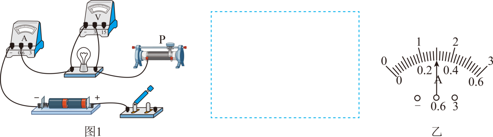

# Physics - 题目 1499

**ID**: d53077d44882419794cc08d9e90cc417
**年级**: Grade 9
**难度**: Medium
**题型**: Experiment

## 题目
如图甲所示，是某小组测量额定电压为2.5V 小灯泡额定功率的实验电路。​​​​​​​‌（1）用笔画线代替导线，将实物图连接完整。并在虚线框内画出对应的电路图；(  )（2）检查电路正确无误后，闭合开关S，发现小灯泡不亮，但电压表、电流表指针均有示数，接下来正确的操作是；（3）当电压表的示数为2.5V时，电流表的示数如图乙所示，则小灯泡的额定电流为A，额定功率为W；（4）如表记录了部分实验数据。分析数据可知灯泡的亮度是由其（选填“实际功率”或“额定功率”）决定的；实验序号电压U/V电流I/A电功率P/W灯泡亮度11.00.140.14很暗21.70.220.374较暗32.5正常43.00.320.96较亮（5）实验中，多次测量的目的是。

## 解答

1. （1）滑动变阻器按一上一下连入电路中与灯串联，如下图所示：
2. 
3. （2）检查电路正确无误后，闭合开关S，但电压表、电流表指针均有示数，则电路为通路，发现小灯泡不亮，说明电路的电流过小，电路的电阻过大，接下来正确的操作是：将变阻器的滑片适当向左移动，观察灯的发光情况。
4. （3）额定电压为2.5V的小灯泡正常工作的电流不会超过0.6A，所以如图乙所示，电流表选择小量程，分度值为0.02A，示数为0.3A，小灯泡在正常电压下的电流为额定电流，所以小灯泡的额定电流为0.3A。
5. 小灯泡的额定功率为 $P=UI=2.5{\rm{V}}\times 0.3{\rm{A}}=0.75{\rm{W}}$
6. （4）分析数据可知灯泡在不同电压下的电功率是不一样的，所以灯泡的亮度是由其实际功率定的。
7. （5）实验中，多次测量的目的是避免实验结论的偶然性，寻找普遍规律，故A不符合题意，B符合题意。

## 知识点

**中文**:
  - 伏安法测量小灯泡的电功率

**English**:
  - Measuring Bulb Power (Voltammetry)

---
