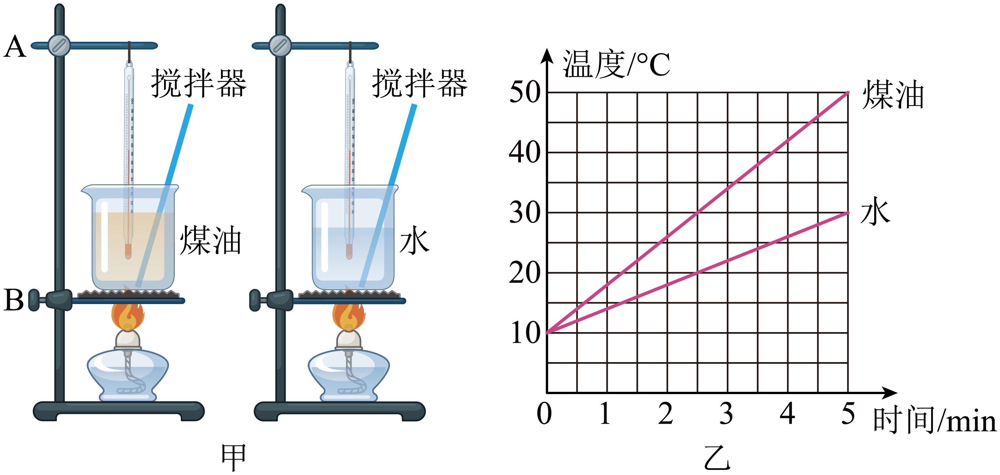

# Physics - 题目 553

**ID**: dc3e8fe24e9243c3890679a6b7d2d91a
**年级**: Grade 9
**难度**: Medium
**题型**: Experiment

## 题目
为了比较水和煤油的吸热能力，小林同学用两个完全相同的装置做了如图甲所示的实验（1）如图甲所示，左侧实验装置温度计的玻璃泡触碰到了杯底，应该将装置中（A向上/B向下）适度调整；（2）在两个烧杯中应加入初温相同的水和煤油，它们的体积应当（相同/不同）；（3）根据实验数据绘制乙图。​​​​​​​‌由图可知从10℃开始加热，当水加热到30℃吸收的热量为Q_{水}，煤油加热到35℃时吸收的热量为Q_{油}，则Q_{水}（<>/=）Q_{油}；（4）实验中吸收相同的热量，发现煤油的温度比水的温度升高得，这表明的吸热能力更强。如果想自制暖手袋，应选用作为供暖物质效果更佳。

## 解答

1. （1）实验中要用酒精灯的外焰加热，安装装置时自下而上安装，如图甲所示，左侧实验装置温度计的玻璃泡触碰到了杯底，应该将装置中的A处向上适度调整。
2. （2）探究物质吸热能力的实验中，需要控制不同物质的质量相同，故在两个完全相同的烧杯中分别装入质量、初温都相同的水和煤油，水和煤油的密度不同，由 $V=\frac {m}{ρ}$ 可知水和煤油的体积不同。
3. （3）由图乙可知从10℃开始加热，水加热到30℃的时间为5分钟，煤油加热到35℃时的时间为3分钟，实验中通过加热时间的长短来比较吸热多少，所以Q_{水}大于Q_{油}。
4. （4）根据图示可知，加热相同时间，吸收相同的热量，发现煤油的温度比水的温度升高得快，这表明水的吸热能力更强，水的比热容大，根据Q=cmΔt，在质量和降低的温度相同时，水放热多，如果想自制暖手袋，应选用水作为供暖物质效果更佳。

## 知识点

**中文**:
  - 物质的比热容探究实验

**English**:
  - Experiment: Investigating Specific Heat Capacity

---
