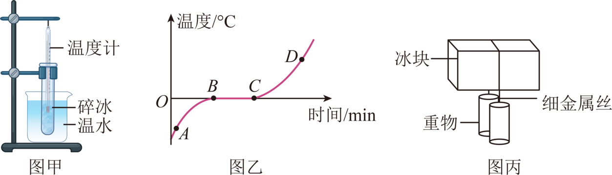

# Physics - 题目 1791

**ID**: dc5dc5cba57c4cf2a2a459f1820c33d7
**年级**: Grade 9
**难度**: Medium
**题型**: Experiment

## 题目
用如图所示实验装置，探究室温下冰熔化时温度的变化规律。​​​​​​​‌（1）图甲将装有碎冰的试管放入冷水中加热，而不是用酒精灯直接对试管加热，这样做的目的是可以使碎冰，同时温度上升速度较，便于读取各个时刻的温度；（2）由实验数据绘制成图乙所示图像，可知，BC段（选填“需要”或“不需”）吸热；由实验可知，冰属于（选填“晶体”或“非晶体”）；（3）研究表明晶体的熔点与压强有关，压强越大，晶体的熔点越低，如图丙所示，在温度较低的环境中，将拴有重物的细金属丝挂在冰块上，金属丝下方与冰接触处的压强，从而使冰的熔点，金属丝下方的冰块熔化后又很快凝固，所以金属丝穿冰块而过且不留缝隙。

## 解答

1. （1） 图甲将装有碎冰的试管放入冷水中加热，而不是用酒精灯直接对试管加热，这叫做水浴法，可以使碎冰受热均匀，同时温度上升速度较慢，便于读取各个时刻的温度。
2. （2）BC段处于熔化过程中，吸收热量，温度保持不变，说明冰有固定的熔化温度，为晶体。
3. （3） 晶体的熔点与压强有关，压强越大，晶体的熔点越低。将拴有重物的细金属丝挂在冰块上，压力一定，金属丝下方与冰接触处的部分受力面积较小，增大了压强，从而降低冰的熔点，使金属丝下方的冰块先其它部分的冰熔化。

## 知识点

**中文**:
  - 晶体和非晶体的区别
  - 熔化和凝固的探究实验

**English**:
  - Difference between Crystals and Amorphous Solids
  - Experiment: Melting and Solidification

---
