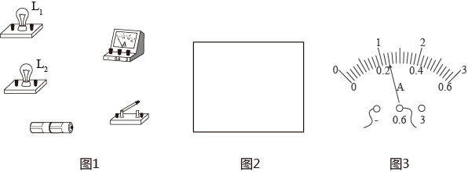

# Physics - 题目 1668

**ID**: e5361ad73fa546da89334027e110f571
**年级**: Grade 9
**难度**: Medium
**题型**: Experiment

## 题目
灯泡 ${\rm{L}}{{}_{1}}$ 和灯泡 ${\rm{L}}{{}_{2}}$ 并联，电流表测量通过灯 ${\rm{L}}{{}_{1}}$ 的电流（没超过 $0.6{\rm{A}}$ ），开关控制整个电路。​​​​​​​‌（1）在如图2所示的方框中画出电路图，并在图1中连接实物图。；（2）开关闭合，若测得通过 ${\rm{L}}{{}_{1}}$ 灯的电流如图3所示，则通过 ${\rm{L}}{{}_{1}}$ 灯的电流是，若通过开关的电流是 $0.34{\rm{A}}$ ，则通过 ${\rm{L}}{{}_{2}}$ 灯的电流是。

## 解答

1. （1）[1]根据题意可知，灯泡L_{1}和灯泡L_{2}并联，电流表测量通过灯L_{1}的电流，则电流表与灯L_{1}串联在支路中，开关控制整个电路，则开关在干路中，如图所示：
2. 
3. 由题意可知电流表应选用小量程，根据电路图连接实物图，如图所示：
4. 
5. $（2）$ 由图3可知，电流表的分度值为 $0.02{\rm{A}}$ ，示数为 $0.24{\rm{A}}$ ，即通过 ${\rm{L}}{{}_{1}}$ 灯的电流
6. $I{{}_{1}}=0.24{\rm{A}}$
7. 若通过开关的电流是0.34A，即干路中的电流为0.34A，由并联电路的电流特点可知，通过 ${\rm{L}}{{}_{2}}$ 灯的电流
8. $I{{}_{2}}=I-I{{}_{1}}=0.34{\rm{A}}-0.24{\rm{A}}=0.1{\rm{A}}$

## 知识点

**中文**:
  - 并联电路的电流规律
  - 电流表的读数
  - 电流表的连接

**English**:
  - Current Law in Parallel Circuits
  - Reading an Ammeter
  - Connecting an Ammeter

---
