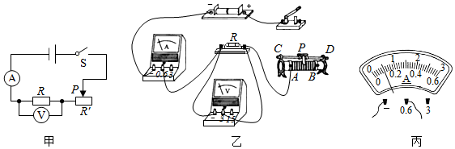

# Physics - 题目 1834

**ID**: e5d88aa673b445a9be0ba91abb4ec778
**年级**: Grade 9
**难度**: Medium
**题型**: Experiment

## 题目
如图所示，小明按照图甲电路图在探究“电流与电压和电阻关系”的实验中，（1）连接电路时开关应；（2）请在乙图中连接电路；（3）闭合开关前，如图乙中滑动变阻器的滑片应位于（选填“A”或“B”）端；（4）小明通过实验得到数据如表（一）所示，其中第1次实验的电流表示数如图丙所示，为A，所用电阻R的值是Ω，根据表（一）的数据，电流与电压成；表（一）实验序号123电阻/ΩR电压/V1.01.52.0电流/A0.150.20表（二）实验序号456电阻/Ω51015电压/V1.52.02.3电流/A0.300.200.15（5）小明继续探究电流与电阻的关系，他先后将5Ω、10Ω和15Ω的电阻接入电路中进行实验，得到数据如表（二）的数据，可知小明在操作过程中存在的错误是：没有控制导体两端的电压（选填“变”或“不变”）。​​​​​​​‌

## 解答

1. （1）为保护电路，连接电路时开关应断开。
2. （2）变阻器应按一上一下串联接入电路中，如下图所示：
3. 
4. （3）开关闭合前，为保护电路，变阻器连入电路的电阻应最大，图乙中滑动变阻器的滑片应位于B端。
5. （4）电流表接入电路的量程是“0～0.6A”，分度值为0.02A，所以电流表的示数为0.1A；由欧姆定律可得电阻R的值
6. $R=\frac {U}{I}=\frac {{\rm{1}}{\rm{.}}{\rm{0}}{\rm{V}}}{{\rm{0}}{\rm{.}}{\rm{1}}{\rm{A}}}{\rm{=}}{\rm{1}}{\rm{0}}Ω$
7. 根据表一中数据可知，电压增大为原来的几倍，通过的电流也增大为原来的几倍，所以可得实验结论为：在电阻一定时；电流与电压成正比。
8. （5）探究电流与电阻的关系，应控制电阻两端电压不变，可知小明在操作过程中存在的错误是：没有控制导体两端的电压不变。
9. 、

## 知识点

**中文**:
  - 电流与电压关系的探究实验
  - 电流与电阻关系的探究实验

**English**:
  - Experiment: Relationship between Current and Voltage
  - Experiment: Relationship between Current and Resistance

---
