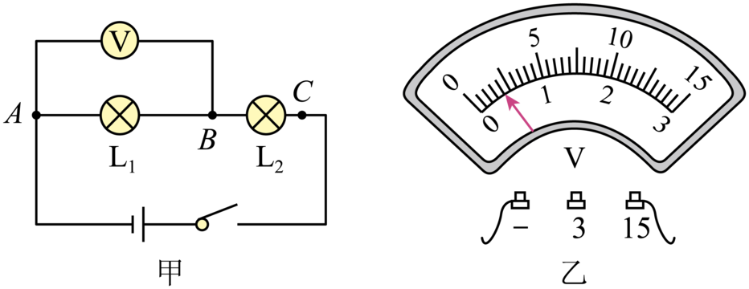

# Physics - 题目 1033

**ID**: e790a258e65f40a39c14b22f304e0c6d
**年级**: Grade 9
**难度**: Medium
**题型**: Experiment

## 题目
“探究串联电路的电压关系”的实验电路如图甲所示。​​​​​​​‌（1）为了使探究得出的结论具有普遍意义，L_{1}、L_{2}应该选择（选填“相同”或“不相同”）的小灯泡；（2）小明根据图甲连接好电路，闭合开关，电压表示数如图乙所示，为了使实验结果更准确，接下来他应该；（3）测出L_{1}两端的电压后，小明断开开关，准备拆下电压表，改装在B、C之间。小聪认为小明的操作太麻烦，只需将与A点相连的导线改接到C点即可。小聪的办法是否正确？。为什么？；（4）测量完成后，进行小组交流讨论，如表选录了四个小组的数据，你认为这些数据是否合理？。理由是。实验小组L_{1}两端电压/VL_{2}两端电压/V串联总电压/V11.43.14.523.01.34.431.11.72.941.81.23.0

## 解答

1. （1）在实验过程中，为了使结论具有普遍意义，应该选取不同的小灯泡进行实验。
2. （2）根据图乙电压表所示情况可知，电压表指针偏转角度太小，误差过大，所以接下来需要断开开关，换用较小量程重新做实验。
3. （3）这样做是不可以的，因为根据电路图分析可以看出，直接改接一端连线，会造成电压表正负接线柱接反。
4. （4）这些数据是合理的；因为虽然实验数据存在差异，但是通过表中数据可以看出，误差允许范围内，在每一组的电源不同的情况下，依照每一组的测量数据之间仍然可以得出串联电路的总电压等于各部分电压之和规律。

## 知识点

**中文**:
  - 探究串、并联电路中的电压规律实验

**English**:
  - Experiment: Voltage Laws in Series/Parallel

---
