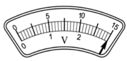

# Physics - 题目 2516

**ID**: ea2c03926ae9475cbeb10572d67e96d2
**年级**: Grade 9
**难度**: Medium
**题型**: Experiment

## 题目
小华同学做“测定小灯泡电功率”实验。​​​​​​​‌待测小灯的额定电压为“2.5V”或“4.0V”，滑动变阻器上标有“50Ω   2A”，实验器材齐全且完好。他连接电路后，将变阻器的滑片置于一端，闭合电键，移动滑片的过程中，观察到小灯发光始终较暗且亮度不变，电流表示数逐渐变大，电压表的指针始终处于图所示位置：(1)小灯发光较暗的原因是。(2)小华在连接电路时的主要问题是。(3)请判断小灯的额定电压为。(4)为了完成实验，小华同学需对电路进行重新正确连接；还需对实验器材进行调整的是。

## 解答

1. (1)[1]小灯泡始终较暗是由于实际功率较小，即小灯泡两端电压太低。
2. (2)[2]由于移动滑片小灯亮度不变，则可知滑动变阻器与小灯泡未串联，移动滑片过程中，电流表示数变大，电压表示数不变，则可知滑动变阻器与小灯泡并联，且电流表位于滑动变阻器所在支路或干路，小灯泡亮度较暗，说明电源电压太低。
3. (3)[3]由图可知电压表示数为3V或15V，由于并联且小灯泡较暗，则说明小灯泡未正常发光，故可得电压表示数应小于小灯泡的额定电压，则小灯额定电压应为4.5V。
4. (4)[4]由实验分析可知，电源电压太低，则还需增大电源电压再继续实验。

## 知识点

**中文**:
  - 伏安法测量小灯泡的电功率

**English**:
  - Measuring Bulb Power (Voltammetry)

---
