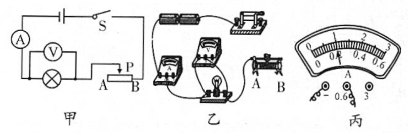
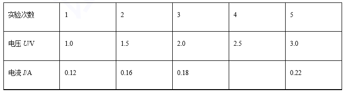
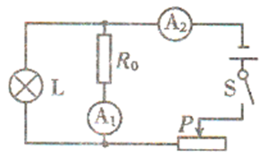

# Physics - 题目 966

**ID**: eb6abb7a79094e46818f0b24327e81cd
**年级**: Grade 9
**难度**: Medium
**题型**: Experiment

## 题目
在“测量小灯泡的电功率”实验中，小丹设计了如图甲所示的电路图，已知小灯泡的额定电压为2.5V，滑动变阻器规格为“20Ω 1A”，电源是由2节新干电池串联组成。​​​​​​​‌（1）用笔画线代替导线，帮助小丹按电路图甲将图乙电路连接完整；（要求导线不交叉）（2）闭合开关前，应将滑动变阻器滑片置于端（填字母）；（3）连接好电路后，闭合开关，发现小灯泡不发光，电流表有示数，电压表无示数，则电路故障可能是；（4）排除故障后，缓慢移动滑动变阻器的滑片，使电压表的示数为2.5V，电流表示数如图丙所示为A，则小灯泡的额定功率为W，此时灯丝的电阻为Ω；（5）小丹继续测量小灯泡两端电压略高于额定电压时的电功率，滑动变阻器的滑片应向（填字母）端调节，观察到小灯泡变亮；（6）下表是小丹根据实验测得的多组数据，她通过分析数据发现小灯泡灯丝的电阻是变化的，则影响小灯泡灯丝电阻变化的主要因素是；（7）小丹经过思考，发现用两只电流表和一个阻值为R的定值电阻也可以测出小灯泡的额定功率。她设计的电路如图所示，具体操作是：闭合开关S，调节滑动变阻器使电流表A_{1}的示数为I_{1}时，小灯泡正常发光，此时电流表A_{2}的示数为I_{2}则小灯泡额定功率的表达式为P_{额}=（用I_{1}、I_{2}、R_{0}表示）

## 解答

1. (1)[1]根据甲图，变阻器右下接线柱连入电路中，如下图所示：
2. 
3. (2)[2]闭合开关前，应将滑动变阻器滑片置于阻值最大处的A端。
4. (3)[3]连接好电路后，闭合开关，电流表有示数，电压表无示数，说明电路为通路，发现小灯泡不发光，则电路故障可能是灯泡短路。
5. (4)[4][5]排除故障后，缓慢移动滑动变阻器的滑片，使电压表的示数为2.5V，电流表示数如图丙所示，电流表选用小量程，分度值为0.02A，电流为0.2A，则小灯泡的额定功率为
6. P=UI=2.5V×0.2A=0.5W
7. [6]由欧姆定律，此时灯丝的电阻为
8. R= $\frac {U}{I}=\frac {2.5{\rm{V}}}{0.2{\rm{A}}}$ =12.5Ω
9. (5)[7]测量小灯泡两端电压略高于额定电压时的电功率，即增大灯两端的电压，减小变阻器两端的电压，由分压原理，应减小变阻器的电阻，故滑动变阻器的滑片应向B端调节。
10. (6)[8]根据实验测得的多组数据，通过分析数据发现小灯泡灯丝的电阻是变化的，说明温度是影响小灯泡灯丝电阻变化的主要因素。
11. (7)[9]闭合开关S，调节滑动变阻器使电流表A_{1}的示数为I_{1}时，小灯泡正常发光，此时电流表A_{2}的示数为I_{2}，由欧姆定律得到R_{0}的电压为
12. U_{0}=I_{1}R_{0}
13. 根据并联电路电压的规律可知灯的额定电压等于R_{0}两端的电压，由并联电路电流的规律得到通过灯的额定电流
14. I_{额}=I_{2}-I_{1}
15. 则小灯泡额定功率的表达式为
16. P_{额}=U_{0}I_{额}=I_{1}R_{0}×(I_{2}-I_{1})

## 知识点

**中文**:
  - 伏安法测量小灯泡的电功率
  - 其他方法测量小灯泡的电功率

**English**:
  - Measuring Bulb Power (Voltammetry)
  - Other Methods for Measuring Bulb Power

---
