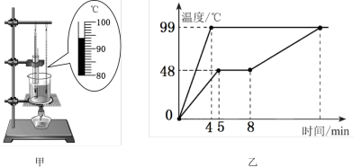

# Physics - 题目 556

**ID**: ec16e3877579466ab06a132f92b9c21e
**年级**: Grade 9
**难度**: Medium
**题型**: Experiment

## 题目
如图甲所示是小明同时探究“水沸腾和晶体熔化时温度变化特点”的实验装置，烧杯中装有适量的水，试管中装有适量的晶体颗粒，水和晶体颗粒中分别放有温度计。​​​​​​​‌（1）某时刻水中温度计的示数如图甲所示，此时水的温度为℃；（2）实验中两个温度计示数随时间变化的图像如图乙所示，晶体颗粒熔化过程所需的时间为min，它的熔点为℃；（3）当试管中的物质温度达到99℃后不再升高，这时它（填“一定”“可能”或“不会”）沸腾；（4）小明分析图像得出：水沸腾和晶体熔化的共同特点是：吸收热量，温度。

## 解答

1. （1）[1]某时刻水中温度计的示数如图甲所示，温度计分度值为1℃，越往上刻度值越大，说明是在零刻度线以上，则此时水的温度为94℃。
2. （2）[2][3]实验中两个温度计示数随时间变化的图像如图乙所示，晶体颗粒达到熔点后在熔化过程中温度保持不变，下面一条线为晶体熔化曲线，所需的时间为3min，它的熔点为48℃。
3. （3）[4]当试管中的物质温度达到99℃后不再升高，与烧杯中水沸腾时的温度相同，由于不存在温度差，无法继续传热，它不会沸腾。
4. （4）[5]分析图像可知，水沸腾和晶体熔化的共同特点是继续吸收热量，但温度保持不变。

## 知识点

**中文**:
  - 探究水的沸腾实验
  - 熔化和凝固的探究实验

**English**:
  - Experiment: Boiling of Water
  - Experiment: Melting and Solidification

---
