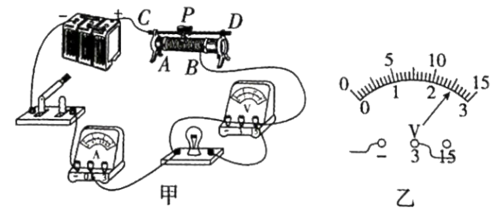

# Physics - 题目 778

**ID**: ef346e54bbc44454b34c03aa8fa870b7
**年级**: Grade 9
**难度**: Medium
**题型**: Experiment

## 题目
图甲是李明为测量小灯泡的额定功率连接的实验电路图，其中电源电压恒为6V，小灯泡标有“3.8V”字样，滑动变阻器标有“20Ω；1A”字样。​​​​​​​‌（1）闭合开关，李明发现小灯泡发光，电流表有示数，但电压表无示数．经检测：电压表的“0~15V”量程接线柱损坏无法使用，“0~3V”量程接线柱完好仍可使用。聪明的李明设计了以下步骤，顺利完成了小灯泡额定功率的测量。请你帮李明将下列操作步骤填写完整；①更换图甲中电压表的量程后闭合开关，移动滑动变阻器的滑片，使电压表示数为V；②断开开关，保持滑片位置不变，将电压表；③闭合开关，移动滑片到某一位置时，电压表示数如图乙所示，若要测量小灯泡的额定功率，应将滑片向（选填“A”或“B”）端移动；在此过程中，电流表的示数（选填“变大”“变小”或“不变”）；④继续移动滑片，当电压表示数为V时，小灯泡正常发光，此时电流表的示数为0.38A，则小灯泡的额定功率为W。（2）实验反思：李明设计步骤①的目的是。

## 解答

1. （1）①灯泡的额定电压为3.8V，电压表应选择0~15V量程，由于电压表大量程损坏，只能使用0~3V量程，故最大的示数只能为3V，如果灯泡两端电压为3V，根据串联电路电压的规律，滑动变阻器此时两端电压为 $U{{}_{滑}}=U-U{{}_{{\rm{L}}}}=6{\rm{V}}-3{\rm{V}}=3{\rm{V}}$ ，电压表此时改接到滑动变阻器两端时也不超量程。
2. ②实验中灯泡的额定电压为3.8V，只能使用0~3V量程，当灯泡正常发光时滑动变阻器两端电压为 $U{{}_{滑}^{^{′}}}=U-U{{}_{额}}=6{\rm{V}}-3.8{\rm{V}}=2.2{\rm{V}}$ ，则可以通过测量滑动变阻器两端电压，间接知道灯泡的电压，故应电压表保持滑片位置不变，将电压表改接到滑动变阻器两端。
3. ③闭合开关，移动滑片到某一位置时，电压表示数如图乙所示，电压表量程为0~3V，分度值为0.1V，读数为2.5V，若要测量小灯泡的额定功率，滑动变阻器两端电压应为2.2V，根据串联电路分压的规律，故应将滑片向B端移动，使接入阻值变小；根据欧姆定律，在此过程中，电流表的示数变大。
4. ④继续移动滑片，当电压表示数为2.2V时，小灯泡正常发光，此时电流表的示数为0.38A，则小灯泡的额定功率为 $P{{}_{{\rm{L}}}}=U{{}_{额}}I{{}_{额}}=3.8{\rm{V}}\times 0.38{\rm{A}}=1.444{\rm{W}}$
5. （2）由于电压表大量程损坏，当灯泡正常发光时，滑动变阻器两端电压为2.2V，可以用0~3V量程测量，实验的原理是通过测量滑动变阻器两端电压间接测量灯泡两端电压，闭合开关前，滑动变阻器应接入最大阻值处，如果直接将电压表并联在滑动变阻器两端也会超量程，只能将电压表先并联在灯泡两端，如果灯泡两端电压为3V，根据串联电路电压的规律，滑动变阻器此时两端电压为3V，均不超量程。

## 知识点

**中文**:
  - 伏安法测量小灯泡的电功率

**English**:
  - Measuring Bulb Power (Voltammetry)

---
