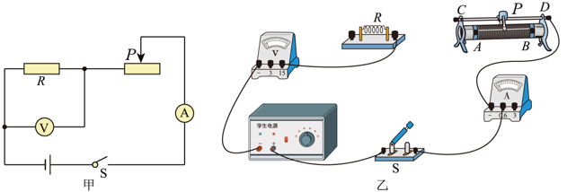

# Physics - 题目 2451

**ID**: f20ceb2fa22f4a4b8cde2ef292daaae3
**年级**: Grade 9
**难度**: Medium
**题型**: Experiment

## 题目
实验小组的同学们用如图甲所示的电路“探究电流与电阻的关系”。​​​​​​​‌电源电压为6V，滑动变阻器规格为“50Ω　2A”，现有5Ω、10Ω、15Ω、25Ω、30Ω的定值电阻各一个。（1）根据图甲将图乙所示的实物连接完整；（2）在该实验中，接入5Ω的电阻，移动滑片P到某一位置时电流表示数为0.4A时，记下电压表示数为 $U{{}_{1}}$ ；（3）将5Ω的电阻分别换成10Ω、15Ω、25Ω、30Ω的电阻，继续实验。小明发现当定值电阻为30Ω时，无法完成实验。为了让30Ω的电阻也能完成实验，他设计了如下三个调整方案，其中错误的是（选填“A”“B”或“C”）。

## 解答

1. （1）由图甲可知，电压表并联在定值电阻两端，滑动变阻器滑片向右移动时阻值变大，故滑动变阻器选用左下接线柱与定值电阻串联。
2. （3）根据欧姆定律可知，定值电阻两端的电压 $U{{}_{{\rm{V}}}}=IR=0.4{\rm{A}}\times 5{\rm{Ω}}=2{\rm{V}}$ ；
3. A．30Ω的电阻接入电路时，电路中的电流 $I^{′}=\frac {U{{}_{{\rm{V}}}}}{R}=\frac {2{\rm{V}}}{30Ω}=\frac {1}{15}{\rm{A}}$ ，则滑动变阻器应接入电路的电阻 $R{{}_{滑}}=\frac {U{{}_{滑}}}{I^{′}}=\frac {U-U{{}_{{\rm{V}}}}}{I^{′}}=\frac {6{\rm{V}}-2{\rm{V}}}{\frac {1}{15}{\rm{A}}}=60{\rm{Ω}}$ ，滑动变阻器的最大阻值为50Ω，所以可以串联一个10Ω的电阻来完成实验，故A正确，不符合题意；
4. B．由于定值电阻的阻值较大，滑动变阻器的最大阻值一定，换用30Ω的电阻时，定值电阻两端分担的电压较大，会大于2V，所以可以通过减小电源电压的方法来完成实验；定值电阻两端的控制电压为2V，故电源电压最小为2V；滑动变阻器阻值最大时，滑动变阻器两端的电压最大，最大电压为 $U{{}_{2}}^{′}=\frac {1}{15}{\rm{A}}\times 50{\rm{Ω}}\approx 3.3{\rm{V}}$ ，则电源的最大电压 $U=2{\rm{V}}+3.3{\rm{V}}=5.3{\rm{V}}$ ，故B错误，符合题意；
5. C．滑动变阻器阻值调至最大时，定值电阻两端控制的电压最小，则最小电压 $U{{}_{{\rm \min }}}=\frac {U}{R{{}_{1}}+R{{}_{2}}}R{{}_{1}}=\frac {6{\rm{V}}}{30Ω+50Ω}\times 30Ω=2.25{\rm{V}}$ 。电源电压为6V，所以控制的最大电压为6V，即 $U{{}_{1}}$ 的取值范围是2.25~6V，故C正确，不符合题意。
6. （4）根据实验可以得出电流与电阻的关系为：电压一定时，通过导体的电流与导体的电阻成反比。

## 知识点

**中文**:
  - 电流与电阻关系的探究实验

**English**:
  - Experiment: Relationship between Current and Resistance

---
