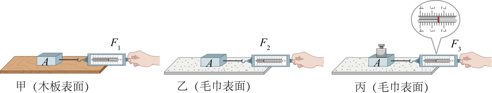

# Physics - 题目 851

**ID**: f2f067db425d49edbddde4abe049d15c
**年级**: Grade 9
**难度**: Medium
**题型**: Experiment

## 题目
在“探究影响滑动摩擦力大小因素”的实验中．（1）如图所示，为测出滑动摩擦力大小，三次实验中均用弹簧测力计沿水平方向拉动木块 A，弹簧测力计的示数F_{1}<F_{2}<F_{3}，图中F_{3}为N．（2）丙图中，若增大弹簧测力计的拉力，此时木块A所受滑动摩擦力变大/变小/不变），木块 A上面的砝码（受/不受）摩擦力．（3）比较两幅图，可得出：压力相同时，接触面越粗糙滑动摩擦力越大．​​​​​​​‌

## 解答

1. 匀速直线拉动时，弹簧测力计示数为摩擦力，读出F_{3}示数为2.4N；滑动摩擦力与压力和接触面粗糙程度有关，改变拉力大小，摩擦力不变，增大拉力做加速运动，则砝码受到向右的摩擦力，比较 甲、乙仅接触面粗糙程度不同，可得出压力相同时，接触面越粗糙滑动摩擦力越大．

## 知识点

**中文**:
  - 影响滑动摩擦力大小因素的探究实验

**English**:
  - Experiment: Factors Affecting Sliding Friction

---
