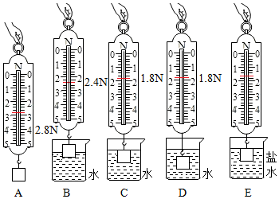

# Physics - 题目 661

**ID**: f9c9ea20710a4d4387020e13fffd43d9
**年级**: Grade 9
**难度**: Medium
**题型**: Experiment

## 题目
小敏在“探究浮力的大小与哪些因素有关”时提出了如下猜想：猜想一：可能与液体的密度有关猜想二：可能与物体排开液体的体积有关猜想三：可能与物体浸没在液体中的深度有关为了验证上述猜想，她按照图中字母顺序做了如下实验：(1)分析比较实验步骤A、B、C，可以验证猜想；分析比较实验步骤入A、C、D ，可以得出浮力的大小与物体浸没在液体中的深度关；(2)分析图中提供的信息。​​​​​​​‌可知图D中物体所受的浮力大小为N；计算可知盐水的密度为kg/m^{3}。如果测力计不拉着物体。物体在水中会（选填“上浮”、“下沉”或“悬浮”）；(3)实验中采用的研究方法（填物理方法）。下列问题研究中也用到这种方法的是。

## 解答

1. (1)[1][2]分析比较实验步骤A、B、C，物体浸入液体中的体积不同，根据 $F{{}_{浮}}=G-F$ 可得物体受到的浮力不同，由此可知，物体受到的浮力与物体浸入液体中的体积有关；分析比较实验步骤A、C、D，物体排开水的体积相同而物体浸没在水中的深度不同，根据  $F{{}_{浮}}=G-F$ 可得物体受到的浮力相等，由此可知，物体受到的浮力与物体浸没在液体中的深度无关。
2. (2)[3][4][5]物体在空气中时弹簧测力计示数为2.8 N，浸没在水中时弹簧测力计的示数为1.8 N，故D中物体所受的浮力大小为1N，浸没在盐水中时弹簧测力计的示数为1.6 N，因此物体在盐水中所受的浮力1.2N，所以物体放入盐水中会下沉 。设物体体积为V，由 $F{{}_{浮}}=p{{}_{液}}gV{{}_{排}}$ 得
3. $F{{}_{浮}}=p{{}_{水}}gV$
4. $F{{}_{盐浮}}=p{{}_{盐水}}gV$
5. 故盐水的密度
6. $ρ{{}_{盐水}}=\frac {F{{}_{盐浮}}ρ{{}_{水}}}{F{{}_{浮}}}=\frac {{\rm{1}}{\rm{.}}{\rm{2}}{\rm{N}}\times {\rm{1}}{\rm{.}}{\rm{0}}\times {\rm{1}}{\rm{0}}{^{{\rm{3}}}}{\rm{k}}{\rm{g}}{\rm{/}}{\rm{m}}{^{{\rm{3}}}}}{{\rm{1}}{\rm{N}}}{\rm{=}}{\rm{1}}{\rm{.}}{\rm{2}}\times {\rm{1}}{\rm{0}}{^{{\rm{3}}}}{\rm{k}}{\rm{g}}{\rm{/}}{\rm{m}}{^{{\rm{3}}}}$
7. (3)[6]控制无关变量相同，只研究一个量随另一个量的变化，用到控制变量法。
8. [7]A．将乒乓球靠近发声的音叉，通过乒乓球被弹开显示音叉在振动，是转换法，故A不符合题；
9. B．为了表示光传播的径迹和方向，引入“光线”的概念是建立物理模型法，故B不符合题意；
10. C．探究影响压力作用效果的因素时，控制无关变量相同，只研究一个量随另一个量的变化，用到控制变量法，故C符合题意；
11. D．用合力代替同一物体上所受到的几个力是等效替代法，故D不符合题意。
12. 故选D。

## 知识点

**中文**:
  - 探究影响浮力大小因素的实验

**English**:
  - Experiment: Factors Affecting Buoyancy

---
