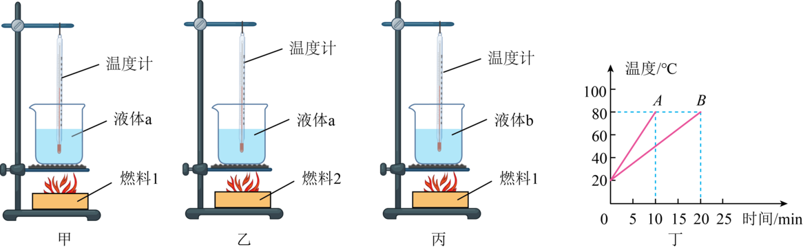

# Physics - 题目 2000

**ID**: fa1e1feb3eff4423aecfa6c6f4c83d96
**年级**: Grade 9
**难度**: Medium
**题型**: Experiment

## 题目
如图所示，甲、乙、丙三图中的装置完全相同，燃料的质量都是10g，烧杯内的液体质量和初温也相同。​​​​​​​‌（1）比较不同物质吸热升温的特点：①应选择两图进行实验；②关于该实验的变量控制，下列要求中不正确的是：

## 解答

1. （1）比较不同物质吸热升温的特点，应控制吸热物质不同，为了使两种物质相同时间内吸收相同热量，应该采用相同热源进行加热，故应该选甲、丙两图。
2. AC．采用相同的加热方法和使用相同的烧杯，都是为了控制不同物质在相同时间内吸收的热量相同，故AC正确，不符合题意；
3. B．烧杯中分别装入相同体积的不同液体，因不同物质的密度不同，根据 $ρ=\frac {m}{V}$ 知，两种物质质量不相等，而实验中应该控制两种液体的质量相等，而不是体积相等，故B错误，符合题意。
4. 如图丁所示，由图可以看出，加热相同的时间，即吸收相同的热量，A液体的温度升高得较快，B液体的温度升高得慢；相同质量的不同液体，吸收相等热量，B液体的温度变化小，故B液体的比热容较大。
5. （2）比较不同燃料的热值，应选择不同的燃料加热相同的物质，所以应该选择甲、乙两图进行实验；燃料燃烧放出的热量多少不便于直接比较，所以利用产生的热量来加热相同质量的同种液体；质量相同的液体，温度变化越大，说明吸收热量越多，所以实验中通过温度计示数来表示燃料放出热量的多少；因为当燃料质量一定时，所取液体的质量如果过少，液体会很快就沸腾，沸腾时温度保持不变，无法计算液体吸收的热量，不便于实验数据的分析比较。

## 知识点

**中文**:
  - 探究燃料的热值实验
  - 物质的比热容探究实验

**English**:
  - Experiment: Investigating Calorific Value
  - Experiment: Investigating Specific Heat Capacity

---
