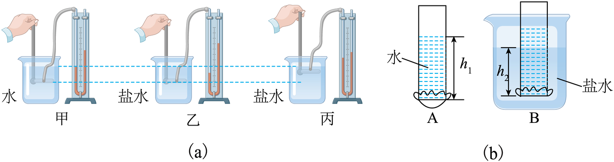

# Physics - 题目 2539

**ID**: fdae4c53358f4de2bdb058e246448e67
**年级**: Grade 9
**难度**: Medium
**题型**: Experiment

## 题目
在“探究影响液体压强大小的因素”实验中，小强做了如图（a）所示的甲、乙、丙三次实验。​​​​​​​‌（1）实验前用手指按压U形管压强计的橡皮膜，发现U形管中的液面升降灵活，说明该装置（填“漏气”或“不漏气”）。（2）图（a）甲、乙实验表明：当液体深度相同时，液体压强与液体的有关；图（a）乙、丙实验表明：同种液体，深度越小，液体的压强越。（3）他结合液体压强的知识，设计了测量盐水密度的方案，请你将以下实验步骤补充完整：①如图（b）中的A所示，用细线和橡皮膜把玻璃管一端扎紧，向管内倒入适量的水，用刻度尺测出水面到下管口的距离记为h₁。②如图（b）中的B所示，在烧杯中装入适量的盐水，将玻璃管缓慢浸入其中，直至橡皮膜水平为止，用刻度尺测出盐水面到下管口的距离记为h₂。③盐水的密度表达式：ρ_{盐水}=（利用ρ_{水}、h₁、h₂等表示）。④按照此实验过程，所测盐水的密度偏（选填“大”或“小”），原因是。

## 解答

1. （1）压强计是通过U形管中液面的高度差来反映被测压强大小的；将橡皮膜置于空气中，U形管两边的液面应该相平；用手轻轻按压几下橡皮膜，如果U形管中的液体能灵活升降，则说明装置不漏气。
2. （2）如图中甲、乙实验，深度不同，U形管两侧液面高度差不同，这表明：当液体深度相同时，液体压强与液体的密度有关。
3. 图乙、丙实验，液体种类相同，深度越小，U形管两侧高度差越小，这表明：同种液体，深度越小，液体压强越小。
4. （3）他结合液体压强的知识，设计了一个测量盐水密度的方案，请你将以下实验步骤补充完整：①如图中A所示，用细线和橡皮膜把玻璃管一端扎紧，向管内倒入适量的水，用刻度尺测出水面到下管口的距离记为h_{1}。②如图中B所示，在烧杯中装入适量的盐水，将玻璃管缓慢浸入其中，直至 橡皮膜水平为止，用刻度尺测出盐水面到下管口的距离记为h_{2}。③因为橡皮水平，说明盐水与水产生的压强相等，即： $ρ{{}_{盐水}}gh{{}_{2}}=ρ{{}_{水}}gh{{}_{1}}$
5. 得盐水的密度表达式  $ρ{{}_{盐水}}=\frac {h{{}_{1}}}{h{{}_{2}}}ρ{{}_{水}}$ 。
6. 按照此实验过程，由于图A中橡皮膜发生形变，造成测量的水深度即h_{1}变小，故密度的测量值偏小。

## 知识点

**中文**:
  - 探究液体压强的特点实验

**English**:
  - Experiment: Characteristics of Liquid Pressure

---
