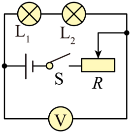

# Physics - 题目 1979

**ID**: 02ac6951f72b4b48813ab03e3d40f9ee
**年级**: Grade 9
**难度**: Medium
**题型**: Fill-in-the-blank

## 题目
如图所示，L_{1}标有“3V  0.9 W”，L_{2}标有“2V  1W”。​​​​​​​‌闭合开关，S在保证电路安全的前提下，调节滑动变阻器的滑片使其中一盏灯泡正常发光，则此时电压表的示数为V。（不考虑灯泡电阻的变化）

## 解答

1. 由图知道，灯泡L_{1}和L_{2}与滑动变阻器串联，电压表测量两个灯泡的总电压，由P=UI计算两灯的额定电流分别为 $I{{}_{1}}=\frac {P{{}_{1}}}{U{{}_{1}}}=\frac {{\rm{0}}{\rm{.}}{\rm{9}}{\rm{W}}}{{\rm{3}}{\rm{V}}}{\rm{=}}{\rm{0}}{\rm{.}}{\rm{3}}{\rm{A}}$ ， $I{{}_{2}}=\frac {P{{}_{2}}}{U{{}_{2}}}=\frac {{\rm{1}}{\rm{W}}}{{\rm{2}}{\rm{V}}}{\rm{=}}{\rm{0}}{\rm{.}}{\rm{5}}{\rm{A}}$ ，根据串联电路中的电流处处相等，因而允许通过的最大电流为0.3A，此时L_{1}正常发光，其电压是3V；由 $P=\frac {U{^{2}}}{R}$ 知道，灯泡L_{2}电阻 $R{{}_{2}}=\frac {U{^{2}}}{P{{}_{2}}}＝\frac {{\left({{\rm{2}}{\rm{V}}}\right)^{2}}}{{\rm{1}}{\rm{W}}}{\rm{=}}{\rm{4}}{\rm{Ω}}$ ，灯泡L的电压U_{2}=IR_{2}=0.3A×4Ω=1.2V，根据串联电路的电压特点知道，电压表的示数U=U_{1}+U_{2}=3V+1.2V=4.2V。

## 知识点

**中文**:
  - 串联电路的电压规律
  - 欧姆定律的应用
  - 电功率的计算及应用

**English**:
  - Voltage Law in Series Circuits
  - Applications of Ohm's Law
  - Calculation and Application of Electric Power

---
