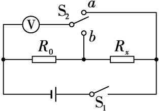

# Physics - 题目 1473

**ID**: 076868071b07420f9c56d1a223492df3
**年级**: Grade 9
**难度**: Medium
**题型**: Fill-in-the-blank

## 题目
如图所示的电路中，电阻R_{0}=12 Ω，闭合开关S_{1}，将单刀双掷开关S_{2}掷于a端，电压表示数为2.5 V；将S_{2}切换到b端，电压表示数为1.5 V，此时电路电流为A，电阻R_{x}的阻值为Ω。​​​​​​​‌

## 解答

1. 将单刀双掷开关S_{2}掷于a端时，电路为R_{0}、R_{x}串联，电压表测电源电压，可知电源电压为2.5V；当将S_{2}切换到b端时，电路连接未变，电压表测定值电阻R_{0}两端电压为1.5V，则可得R_{x}的电压为 $U{{}_{R{{}_{x}}}}=U-U{{}_{R{{}_{0}}}}=2.5{\rm{V}}-1.5{\rm{V}}=1{\rm{V}}$ ，此时电路中的电流为 $I=\frac {U{{}_{R{{}_{0}}}}}{R{{}_{0}}}=\frac {1.5{\rm{V}}}{12{\rm{Ω}}}=0.125{\rm{A}}$，R_{x}的电阻为 $R{{}_{x}}=\frac {U{{}_{R{{}_{x}}}}}{I}=\frac {1{\rm{V}}}{0.125{\rm{A}}}=8{\rm{Ω}}$

## 知识点

**中文**:
  - 与欧姆定律有关的动态电路计算

**English**:
  - Calculations in Dynamic Circuits using Ohm's Law

---
