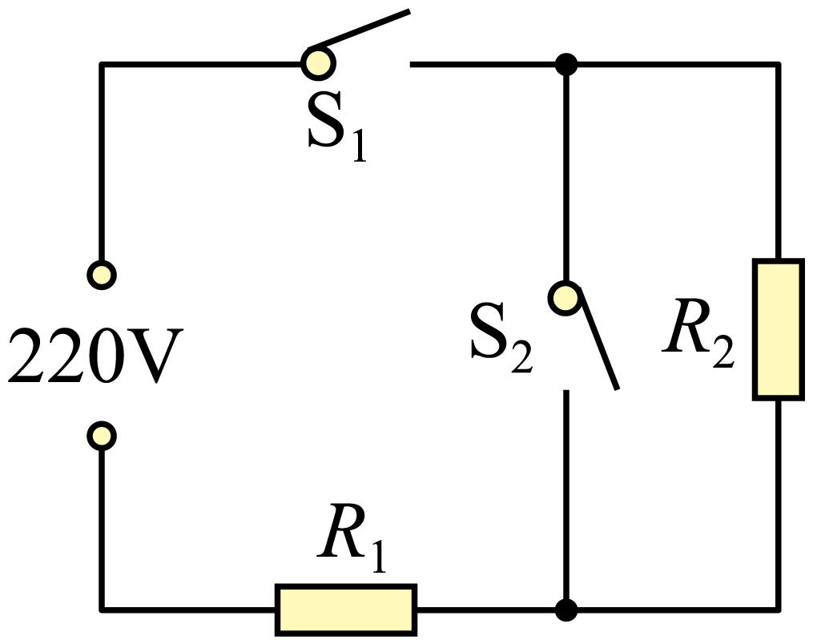

# Physics - 题目 591

**ID**: 09281671537b4a43b0ebebc99c0a5b38
**年级**: Grade 9
**难度**: Medium
**题型**: Fill-in-the-blank

## 题目
如图为一电热饮水机的电路简图，其额定电压为220V，具有“加热”、“保温”两种功能，对应功率分别为400W和40W。​​​​​​​‌则R_{2}的阻值为Ω，电热饮水机在加热挡工作5min产生的热量为J。

## 解答

1. 当开关S_{1}、S_{2}均闭合时，电路为R_{1}的简单电路，电路的总电阻最小，由 $P=\frac {U{^{2}}}{R}$ 可知电路的总功率最大，饮水机处于加热挡，R_{1}的阻值 $R{{}_{1}}=\frac {U{^{2}}}{P{{}_{加热}}}=\frac {（220{\rm{V}}）{^{2}}}{400{\rm{W}}}=121\Omega $ ，当开关S_{1}闭合、S_{2}断开时，R_{1}、R_{2}串联，电路的总电阻最大，功率最小，处于保温状态；总阻值 $R=\frac {U{^{2}}}{P{{}_{保温}}}=\frac {（220{\rm{V}}）{^{2}}}{40{\rm{W}}}=1210\Omega $ ，根据串联电路的总电阻等于各电阻之和可得 $R{{}_{2}}＝R-R{{}_{1}}＝1210Ω-121Ω＝1089Ω$
2. [2电热饮水机在加热挡工作5min产生的热量为 $Q{{}_{放}}＝W＝P{{}_{加热}}t＝400{\rm{W}}\times 5\times 60{\rm{s}}＝1.2\times 10{^{5}}{\rm{J}}$

## 知识点

**中文**:
  - 焦耳定律的计算公式及其应用
  - 电路的动态分析
  - 电功率的计算及应用

**English**:
  - Formula and Application of Joule's Law
  - Dynamic Circuit Analysis
  - Calculation and Application of Electric Power

---
