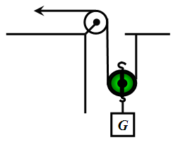

# Physics - 题目 2515

**ID**: 0bc371711f7e4b929d17e453015565f5
**年级**: Grade 9
**难度**: Medium
**题型**: Fill-in-the-blank

## 题目
工人借助如图所示的装置，在20s时间内将700N重的货物匀速提升了4m，已知他对绳子的拉力为500N。​​​​​​​‌该工程中，工人所用装置的机械效率为，工人对绳子的拉力的功率为W。

## 解答

1. 有两段绳子承担总重，绳子自由端移动的距离 $S=2h=2\times 4{\rm{m}}=8{\rm{m}}$ ，工人所用装置的机械效率 $η{\rm{=}}\frac {W{{}_{有}}}{W{{}_{总}}}\times {{1}}{{0}}{{0}}{\rm{\%}}{\rm{=}}\frac {Gh}{Fs}\times {{1}}{{0}}{{0}}{\rm{\%}}{\rm{=}}\frac {700{\rm{N}}\times 4{\rm{m}}}{500{\rm{N}}\times 8{\rm{m}}}\times {{1}}{{0}}{{0}}{\rm{\%}}{\rm{=}}70\%$ ；根据功率的公式可知，工人对绳子的拉力的功率 $P=\frac {W}{t}{\rm{=}}\frac {500{\rm{N}}\times 8{\rm{m}}}{20{\rm{s}}}{\rm{=}}200{\rm{W}}$ 。

## 知识点

**中文**:
  - 功、功率、机械效率的综合计算

**English**:
  - Comprehensive Calculation of Work, Power, and Efficiency

---
