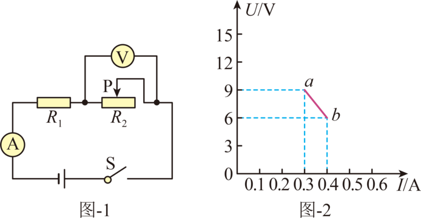

# Physics - 题目 1758

**ID**: 0c8a428857a04357abad2d000c817bc8
**年级**: Grade 9
**难度**: Medium
**题型**: Fill-in-the-blank

## 题目
如图-1所示的电路中．电源电压保持不变， $R{{}_{1}}$ 为定值电阻。​​​​​​​‌当滑动变阻器 $R{{}_{2}}$ 的滑片P从a点移到b点时，滑动变阻器的 $U-I$ 图像如图-2所示。在滑片P移动过程中，电压表的示数与电流表的示数比值（选填“变大”“变小”或“不变”）；电源电压为V；定值电阻 $R{{}_{1}}$ 的阻值为$Ω$ ，该电路消耗的最大电功率为W。

## 解答

1. 由图1知道，R_{1}与R_{2}串联，电压表测量滑动变阻器R_{2}两端的电压，电流表测量电路中的电流，由图-2知道，当滑动变阻器R_{2}的滑片P从a点移到b点时电流表的示数变大，由欧姆定律知滑动变阻器的电阻变小，由 $R=\frac {U}{I}$ 知道，电压表的示数与电流表的示数比值等于滑动变阻器的阻值，即电压表的示数与电流表的示数比值变小；由图像知道，此时电路中的电流I_{a}=0.3A，R_{2}两端的电压U_{2}=9V，串联电路中总电压等于各分电压之和，所以电源的电压 $U=I{{}_{a}}R{{}_{1}}+U{{}_{2}}=0.3{\rm{A}}\times R{{}_{1}}+9{\rm{V}}$ ①，由图像知道，这时电路中电流为I_{b}=0.4A，R_{2}两端的电压U_{2}′=6V，则 $U=I{{}_{b}}R{{}_{1}}+U{{}_{2}}\prime =0.4{\rm{A}}\times R{{}_{1}}+6{\rm{V}}$ ②，联立①②解得R_{1}=30Ω，U=18V，当滑动变阻器接入电路的电阻为零时，电路消耗的电功率最大，该电路消耗的最大电功率为 $P=\frac {U{^{2}}}{R{{}_{1}}}=\frac {{\left({{{1}}{{8}}{\rm{V}}}\right)^{2}}}{{{3}}{{0}}{\rm{Ω}}}{\rm{=}}{{1}}{{0}}{{.}}{{8}}{\rm{W}}$ 。

## 知识点

**中文**:
  - 与欧姆定律有关的动态电路计算

**English**:
  - Calculations in Dynamic Circuits using Ohm's Law

---
