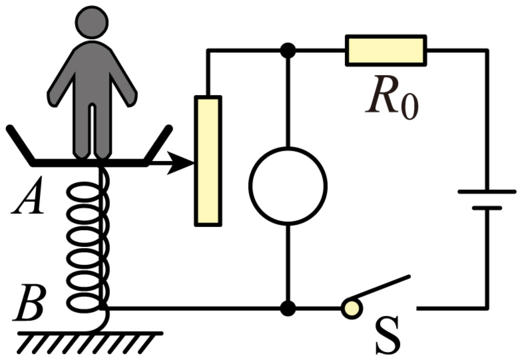

# Physics - 题目 1319

**ID**: 14f71b7989b8432a805c9f7550972a4c
**年级**: Grade 9
**难度**: Medium
**题型**: Fill-in-the-blank

## 题目
某电子体重计的电路如图所示,其中弹簧上端和滑动变阻器的滑片固定在一起,AB间有伸缩的导线使电路连通,R_{0}是保护电阻,其中体重示数计是由(填“电流”或“电压”表改装而成的.​​​​​​​‌当称量体重减小时,电阻R_{0}的电功率将(填“增大”、“不变“或“减小”）.

## 解答

1. 滑动变阻器与R_{0}串联，体重示数计与滑动变阻器并联，故体重示数计是由电压表改装而成的；当称量的体重减小时，滑片向上滑动，接入电路的阻值变小，电路中的总电阻随之变小，由 $I=\frac {U}{R}$ 可得电路中电流变大，根据P=I^{2}R可知，电阻R_{0}的电功率将变大．

## 知识点

**中文**:
  - 与欧姆定律有关的动态电路计算
  - 电功率的计算及应用

**English**:
  - Calculations in Dynamic Circuits using Ohm's Law
  - Calculation and Application of Electric Power

---
